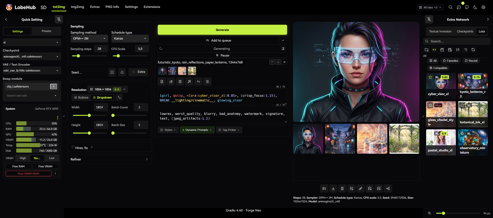
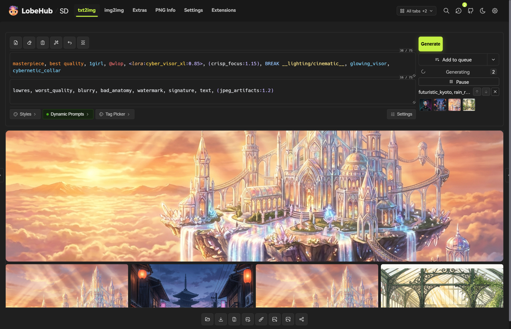
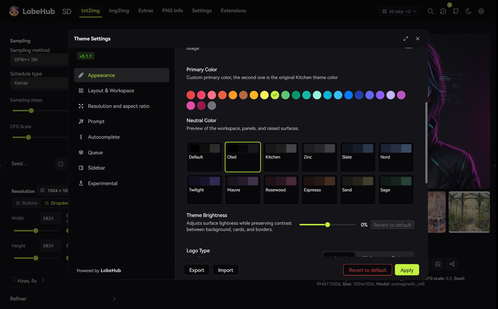
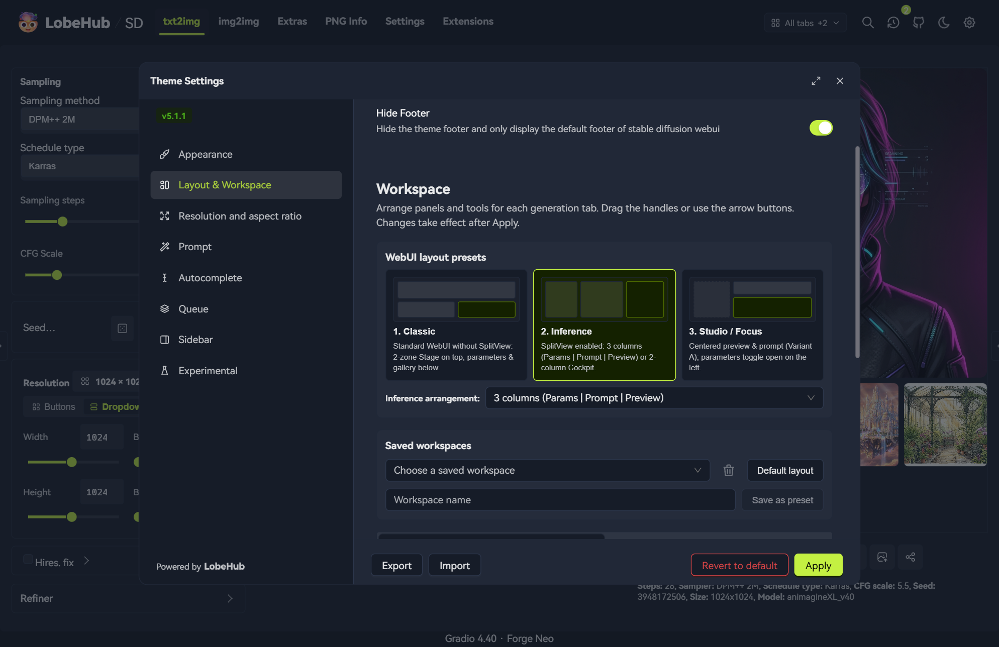
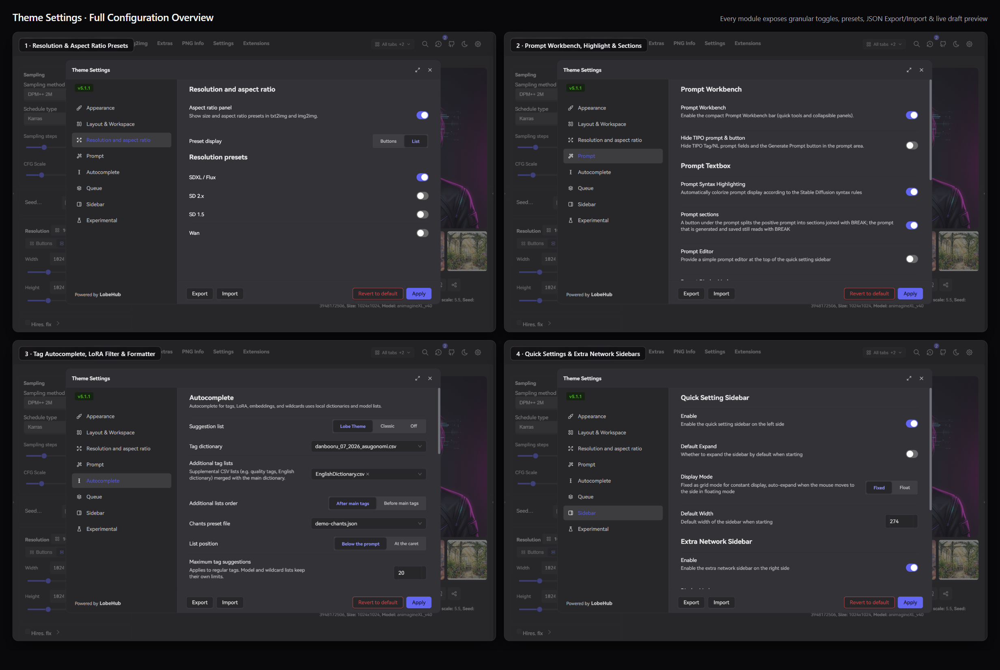
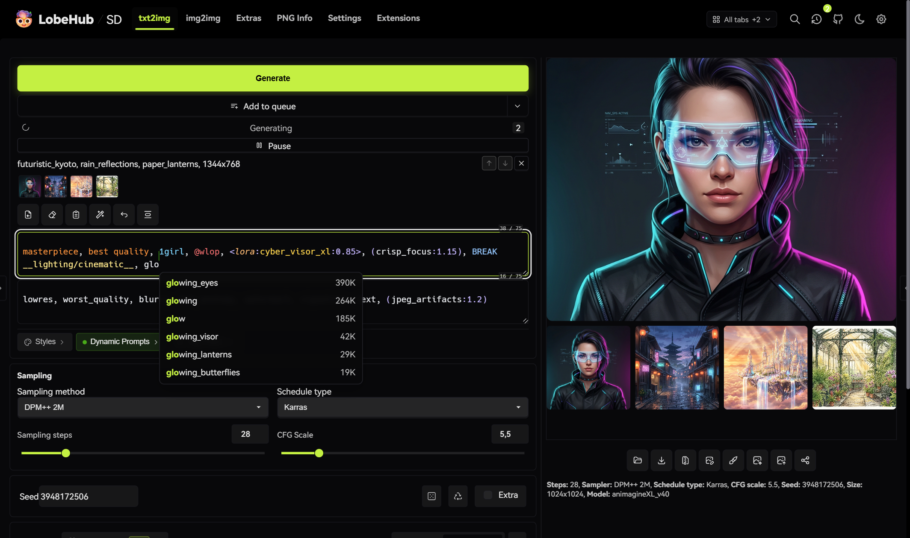
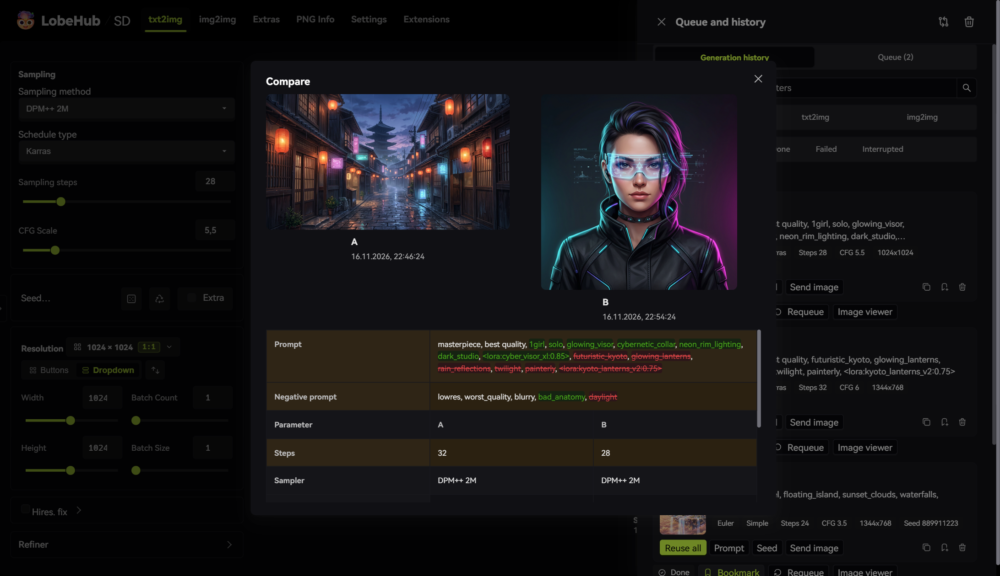
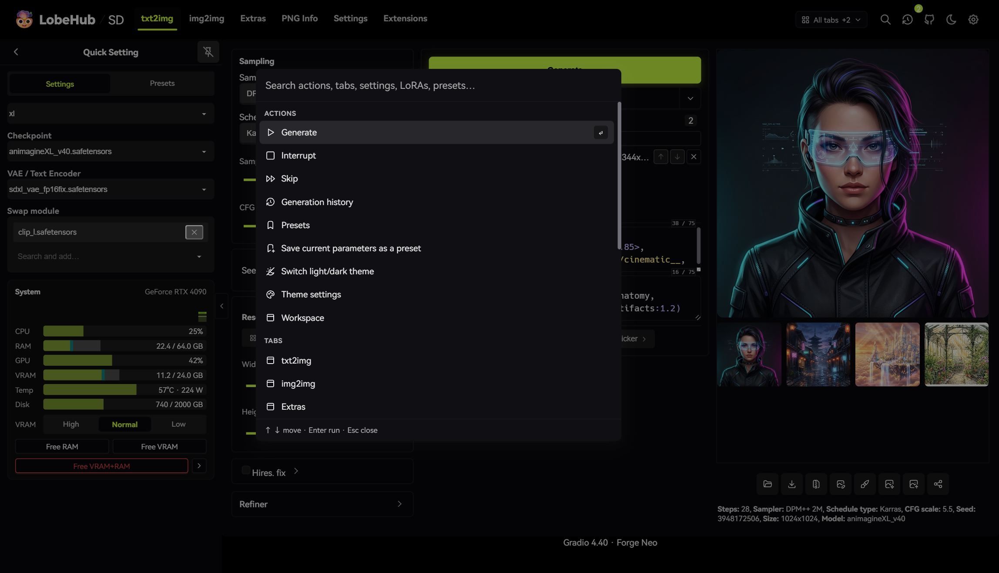
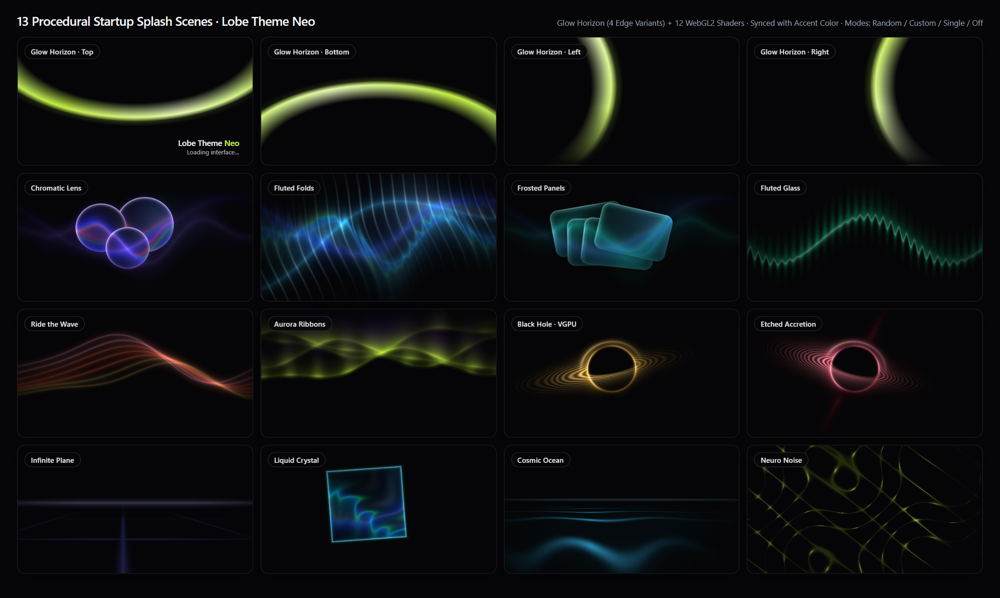
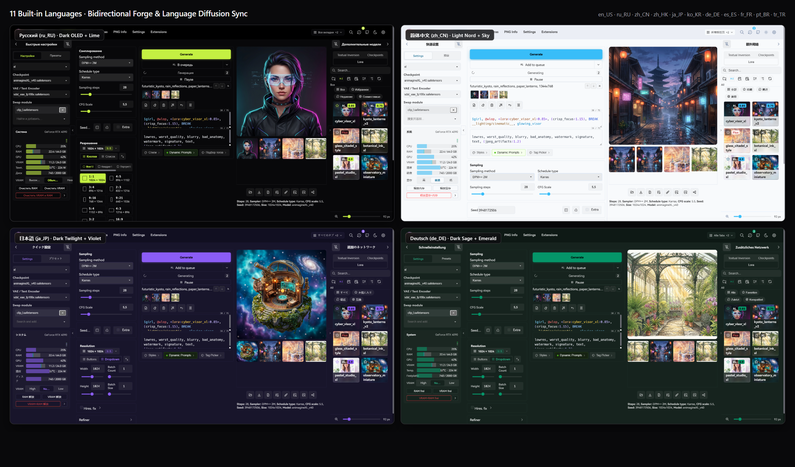

<div align="center">

# Lobe Theme Neo

Customizable workspace theme and built-in productivity tools for Stable Diffusion WebUI Forge Neo

[](./package.json)
[](https://github.com/Haoming02/sd-webui-forge-classic/tree/neo)
[](./package.json)
[](./package.json)
[](#internationalization-and-fonts)
[](./LICENSE)

[English](./README.md) · [Русский](./README.ru-RU.md) · [简体中文](./README.zh-CN.md)

<br />


*Dark mode (`OLED` neutral palette, `Lime` accent), `1. Classic` preset*

</div>

---

## Overview and Layout Presets

Lobe Theme Neo rebuilds the Stable Diffusion WebUI Forge Neo (Gradio 4.x) interface using React 19, Ant Design 6, @lobehub/ui v6, and TypeScript, replacing default WebUI emojis with Tabler outline SVG icons. Along with theming, the extension bundles an SQLite generation queue, generation history with A/B visual comparison, Memory Keeper for VRAM/RAM inspection, prompt syntax highlighting with built-in tag autocomplete, customizable layouts, and 13 procedural startup splash screens.

<table>
  <tr>
    <td width="50%" valign="top">
      <a href="./docs/assets/hero-dark-inference.png">
        
      </a>
      <p align="center"><b>Dark · OLED + Lime · 2. Inference (3 Columns)</b><br /><sub>Params, Prompt, and Preview columns with queue widget and 2×2 Sampling grid</sub></p>
    </td>
    <td width="50%" valign="top">
      <a href="./docs/assets/preview-light-studio.png">
        
      </a>
      <p align="center"><b>Light · Nord + Sky · 1. Classic</b><br /><sub>Light theme with aspect ratio preset buttons and Extra Network sidebar tabs</sub></p>
    </td>
  </tr>
  <tr>
    <td colspan="2" align="center" valign="top">
      <a href="./docs/assets/preview-studio-focus.png">
        
      </a>
      <p align="center"><b>Dark · Kitchen + Lime · 3. Studio / Focus</b><br /><sub>Compact prompt and Generate bar above a centered preview with collapsible settings drawer</sub></p>
    </td>
  </tr>
</table>

---

## Appearance and Workspace Customization

Colors, surface brightness, corner radii, control density, custom branding, and panel layouts update without reloading the page, and settings can be backed up or shared via JSON Export / Import.

### Color Engine, Surfaces, and CIELAB Brightness



- **Theme mode:** switch `Auto`, `Light`, and `Dark` from the header bar or follow the OS theme.
- **24 accent colors:** `Lime`, `Crimson`, `Kitchen`, `Amber`, `Gold`, `Emerald`, `Teal`, `Cyan`, `Sky`, `Blue`, `Indigo`, `Violet`, `Purple`, `Pink`, `Rose`, `Mono`, and more, with accessible text contrast calculation for primary buttons and active labels.
- **12 neutral palettes:** `Default`, `OLED`, `Kitchen`, `Zinc`, `Slate`, `Nord`, `Twilight`, `Mauve`, `Rosewood`, `Espresso`, `Sand`, and `Sage`.
- **CIELAB brightness (`-30%` to `+30%`):** shifts surface lightness in 5% steps while maintaining text-to-border contrast.
- **Surfaces, corners, and spacing:** `Flat`, `Glass` (translucent blur), and `Elevated`; `Round`, `Soft`, or `Sharp` corners; `Comfortable` or `Compact` density.
- **Custom logo, favicon, and SVG icons:** set a custom emblem via URL, Base64, or text with synced canvas PNG favicon generation, plus automatic Tabler SVG replacement for WebUI emojis.
- **Progress bar and result effects:** `Aurora` gradient bar with step counter and ETA or `Classic` mode, plus optional result frame effects (`Glow edge`, `Pulse`, `Ambient`, `Scan`, `Orbit`).

### Flexible Workspace



- **3 layout presets:**
  1. **Classic:** responsive two-zone layout with generation parameters beside the preview column.
  2. **Inference (Multi-Column):** 3 parallel columns (`Params | Prompt | Preview` or `Preview | Prompt | Params`) or 2-column Cockpit for wide displays.
  3. **Studio / Focus:** centered preview below a compact top Prompt + Generate bar, with parameters tucked into a toggleable drawer.
- **Sortable panels and profiles:** reorder or hide accordions (`Sampling`, `Seed`, `Resolution`, `Hires. fix`, `Refiner`, extensions) independently for `txt2img` and `img2img`, customize prompt box height, and save up to 8 named profiles.
- **Sidebars:** pin (`Fixed`) or overlay (`Float`) the left Quick Settings sidebar (`Settings | Presets`) and right Extra Networks sidebar, drag to resize widths, and scale cards from 64 px to 256 px.

### Theme Settings Overview



Each module has its own tab inside **Theme Settings** (`Appearance`, `Layout & Workspace`, `Resolution and aspect ratio`, `Prompt`, `Autocomplete`, `Queue`, `Sidebar`, `Experimental`). Changes stay in draft until applied with `Apply`.

---

## Built-in Tools

### Prompt Workbench, Syntax Highlighting, and Tag Autocomplete



- **Prompt Workbench:** collapsible `Styles`, `Dynamic Prompts`, and `Tag Picker` panels paired with compact prompt actions (read parameters, clear, copy, format, undo/redo, sections).
- **Prompt Sections:** splits prompts on `BREAK` into editable section cards with per-section token counts.
- **Syntax highlighting:** independent color toggles for Danbooru/e621 tag categories, `<lora:...>` models, weights and brackets `(tag:1.2)`, wildcards `__path/name__`, and `BREAK` / `AND` keywords.
- **Autocomplete and Dynamic Prompts:**
  - Bundles Danbooru and Gelbooru tag dictionaries, an English dictionary, Chants presets, and 1,702 wildcard files (`assets/wildcards/`) with a Wildcards Manager tab (`scripts/dynamic_prompts.py`).
  - Filters `<lora:...>` completions by the active checkpoint architecture (`SDXL`, `Flux`, `Illustrious`, `SD 1.5`, `Pony`, `SD 3`, etc.), inserting known trigger words and ANIMA `@artist` prefixes.
  - Sorts tags by local SQLite usage frequency, dims tags already present in the prompt, and formats prompts with diff preview (`Alt+Shift+F` or on blur).

### Generation Queue, History, and A/B Compare



- **Built-in Queue:** `Add to queue` split button (`Ctrl/Cmd+Shift+Enter`) and inline progress card below `Generate`, supporting pause/resume, priority reordering, JSON import/export, and automatic migration from `agent-scheduler-neo`.
- **Batch runs and completion actions:** enqueue parameters for the current checkpoint, picked checkpoints, a folder, or all checkpoints, with optional post-queue actions (nothing, sleep, hibernate, shutdown, or stop WebUI).
- **History and A/B Compare:** stores up to 2,000 entries and thumbnails in `lobe_data/theme.sqlite3` with full-text search, bookmarks, `Reuse all` / `Prompt` / `Seed`, `Save as Preset`, a results strip with Lightbox navigation (`Left` / `Right` / `Esc`), and side-by-side comparison highlighting `TokenDiff` prompt and parameter differences.

### Memory Keeper, System Monitor, and Command Palette



- **Memory Keeper:** VRAM and RAM bars split across WebUI, subprocesses, and other apps. Expanding details reveals loaded Checkpoints (UNet, Text Encoder, VAE breakdown) and LoRAs with pinning (`Keep` across restarts), offload to RAM, selective unload, and live `VRAM Mode` switching (`High` / `Normal` / `Low`) without restarting WebUI.
- **System Resource Monitor:** NVML telemetry for CPU, RAM, GPU load, VRAM usage, temperature, power draw sparklines, and disk capacity.
- **Command Palette (`Ctrl+K` / `⌘K`):** fuzzy launcher for actions (`Generate`, `Interrupt`, `Skip`, presets, samplers, schedulers, checkpoints, LoRAs, recent history, settings, tabs) alongside a searchable All Tabs popover with custom pinning.

### Startup Splash Screens



Prevents unstyled white flashes before Gradio finishes mounting with 13 procedural startup scenes: CSS **Glow Horizon** in 4 edge orientations (`Top`, `Bottom`, `Left`, `Right`) and 12 real-time WebGL2 shaders (`Chromatic Lens`, `Fluted Folds`, `Frosted Panels`, `Fluted Glass`, `Ride the Wave`, `Aurora Ribbons`, `Black Hole · VGPU`, `Etched Accretion`, `Infinite Plane`, `Liquid Crystal`, `Cosmic Ocean`, `Neuro Noise`). Scene colors follow your active accent color and support `Random`, `Custom`, `Single`, and `Off` modes.

---

## Additional Features

- **LoRA card tools:** hover weight adjustment (`−` / value / `+` and mouse wheel syncing directly with prompt text), favorites, quick filters (`All`, `Favorites`, `Recent`, `Compatible`), trigger-word insertion, and architecture compatibility badges (`XL`, `Flux`, etc.).
- **Resolution and aspect ratio panel:** switch between `Dropdown` and quick-pick `Buttons` (`SDXL/Flux`, `SD 2.x`, `SD 1.5`, `Wan`), width/height swap `⇄`, proportional Ratio Lock slider syncing, model-recommended settings badges, 2×2 Sampling layout, and Chaotic Seed generator.
- **Windows Safetensors compatibility:** `safetensors_compat.py` configures `backend="pread"` to prevent Windows `mmap` allocation errors on checkpoints over 4 GB.
- **Parameter presets:** save sampler, steps, CFG, size, and optionally Seed or Batch settings directly inside the Quick Settings sidebar.

---

## Internationalization and Fonts



- **11 languages:** `English (en_US)`, `简体中文 (zh_CN)`, `繁體中文 (zh_HK)`, `Русский (ru_RU)`, `日本語 (ja_JP)`, `한국어 (ko_KR)`, `Deutsch (de_DE)`, `Español (es_ES)`, `Français (fr_FR)`, `Português (pt_BR)`, and `Türkçe (tr_TR)`, with bidirectional sync for Forge native localizations and `sd-webui-language-diffusion`.
- **Offline fonts:** UI fonts (`HarmonyOS Sans`, `Inter`, `Geist`, `System UI`) and prompt monospace fonts (`Hack`, `Geist Mono`, `System UI`) are bundled locally in `assets/fonts/` with zero external CDN requests.

---

## Compatibility and Shortcuts

| Feature / Extension | Status | Notes |
| --- | --- | --- |
| **Forge Neo (Gradio 4.x)** | Native | Built for Forge Neo's DOM, Gradio 4 components, and model presets |
| **Built-in Tag Autocomplete** | Built-in | Automatically yields if an external `a1111-sd-webui-tagcomplete` extension is installed |
| **Built-in Dynamic Prompts** | Built-in | Registers bundled scripts and Wildcards Manager (`assets/wildcards/`) when no external DP is active |
| **Built-in Queue** | Built-in | Migrates pending jobs and history from `agent-scheduler-neo` SQLite DB if found |
| **ADetailer / ControlNet / TIPO** | Optional | Themed with Tabler SVG icons and compatibility hooks only when installed by the user |
| **SD WebUI 1.x / A1111 (Gradio 3)** | Not targeted | For Gradio 3 WebUIs, use upstream [`lobehub/sd-webui-lobe-theme`](https://github.com/lobehub/sd-webui-lobe-theme) |

<details>
<summary><b>Keyboard Shortcuts</b></summary>

| Shortcut | Action |
| --- | --- |
| `Ctrl+K` / `⌘K` | Open Command Palette |
| `Ctrl+Enter` / `⌘Enter` | Generate |
| `Ctrl+Shift+Enter` / `⌘Shift+Enter` | Add current prompt to Queue |
| `Alt+Shift+F` | Format prompt with Diff Preview |
| `←` / `→` / `Esc` | Navigate or close Results Lightbox / Compare modal |

</details>

---

## Installation and Updating

### Method 1: Forge Neo UI (Recommended)

> Pre-built frontend assets (`javascript/main.mjs` and `javascript/chunks/*`) are included directly in the repository. Node.js is not required.

1. Open Stable Diffusion WebUI Forge Neo.
2. Go to **Extensions → Install from URL**.
3. Enter the repository URL and click **Install**:
   ```text
   https://github.com/LeonWGal/lobe-theme-neo
   ```
4. Under **Extensions → Installed**, click **Check for updates**, then **Apply and restart UI**.

### Method 2: Git Clone

```bash
cd path/to/sd-webui-forge-neo/extensions
git clone https://github.com/LeonWGal/lobe-theme-neo.git
```

Restart Forge Neo from your launcher so `preload.py` and the `/lobe/*` backend routes load on startup.

> [!NOTE]
> User configuration (`lobe_theme_config.json`) and local databases inside `lobe_data/` are gitignored, so Git updates preserve your settings and history.

---

## Development and Testing

Stack: React 19, Ant Design 6, @lobehub/ui v6, antd-style, Zustand, Vite 5, TypeScript, and Python.

### Frontend

```bash
npm install

# Run Vite dev server
npm run dev

# Build production bundle into javascript/main.mjs & javascript/chunks/
npm run build

# Run ESLint and TypeScript type check
npm run ci

# Run Vitest unit suite
npm test
```

### Python Tests

Run from the Forge Neo Python environment:

```bash
python -B -m unittest discover -s tests -p "test_*.py" -v
```

### Repository Structure

```text
lobe-theme-neo/
├── assets/
│   ├── autocomplete/       # Danbooru/Gelbooru/English dictionaries, chants & JS engine
│   ├── boot/               # WebGL2 startup shader scenes (scenes.mjs)
│   ├── fonts/              # Local HarmonyOS Sans, Inter, Geist, Hack, Mono webfonts
│   └── wildcards/          # 1,702 bundled wildcard prompt templates
├── docs/assets/            # README showcase screenshots
├── javascript/             # Pre-built Vite bundle + aspect_ratio, boot & queue bridges
├── locales/                # 11 UI translation bundles + options.json
├── scripts/                # FastAPI routes, SQLite queue/history, Memory Keeper, DP & pread patch
├── src/                    # React 19 / TypeScript UI source
└── tests/                  # Vitest and Python unittest suites
```

---

## Credits and License

- Based on [sd-webui-lobe-theme](https://github.com/lobehub/sd-webui-lobe-theme) by LobeHub, migrated to Gradio 4.x / React 19 / Ant Design 6 and expanded for Forge Neo.
- Bundled tag completion and dynamic prompting adapted from `a1111-sd-webui-tagcomplete` / `sd-webui-tagcomplete-neo` and `sd-dynamic-prompts`.
- Licensed under the GNU Affero General Public License v3.0 ([AGPL-3.0](./LICENSE)).
