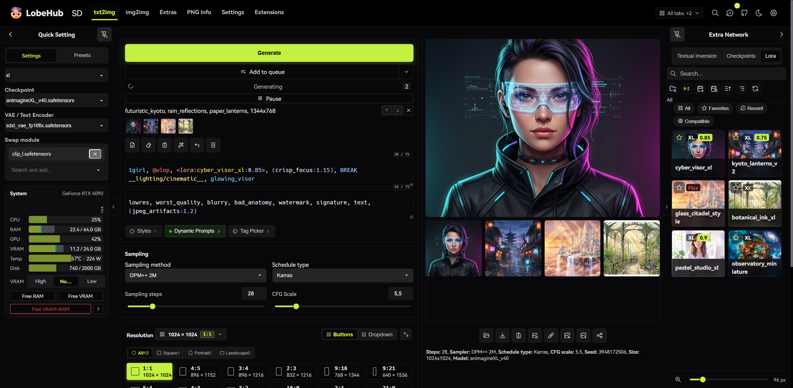
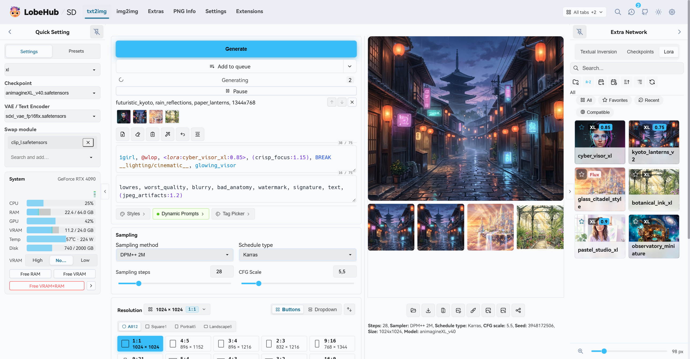

<div align="center">


# Lobe Theme Neo

**Modern, deeply customizable workspace theme & productivity suite for Stable Diffusion WebUI Forge Neo**

[](./package.json)
[](https://github.com/Haoming02/sd-webui-forge-classic/tree/neo)
[](./package.json)
[](./package.json)
[](#-internationalization--fonts)
[](./LICENSE)

[English](./README.md) · [Русский](./README.ru-RU.md) · [简体中文](./README.zh-CN.md)

<br />



*Dark mode (`OLED` neutral palette · canonical `Lime` accent) · `1. Classic` Split preset with top `Generate`, Aspect Ratio quick buttons, docked Quick Settings, System Monitor & Extra Networks sidebars*

</div>

---

## ✨ Highlights & Layout Presets

**Lobe Theme Neo** reimagines **Stable Diffusion WebUI Forge Neo (Gradio 4.x)** as a fast, uncluttered AI creative workspace powered by **React 19**, **Ant Design 6**, **@lobehub/ui v6**, **TypeScript**, and **Tabler Outline SVG Icons**. Alongside a responsive layout engine that places primary `Generate` / `Add to queue` actions cleanly above prompts across every preset, it bundles zero-config productivity tools directly inside Forge Neo—a persistent SQLite generation queue & A/B visual history comparator, live VRAM/RAM Memory Keeper, syntax-highlighted prompt studio with bundled Danbooru/Gelbooru autocomplete & Dynamic Prompts, drag-and-drop workspace profiles, and 13 procedural startup splash screens.

<table>
  <tr>
    <td width="50%" valign="top">
      <a href="./docs/assets/hero-dark-inference.png">
        
      </a>
      <p align="center"><b>Dark · OLED + Lime · 2. Inference (3-Column)</b><br /><sub>Parallel Params, Prompt & Preview columns with 2×2 Sampling & inline queue</sub></p>
    </td>
    <td width="50%" valign="top">
      <a href="./docs/assets/preview-light-studio.png">
        
      </a>
      <p align="center"><b>Light · Nord + Sky · 1. Classic Split</b><br /><sub>Zero-reload Light mode with Aspect Ratio quick buttons & segmented Extra Network tabs</sub></p>
    </td>
  </tr>
  <tr>
    <td colspan="2" align="center" valign="top">
      <a href="./docs/assets/preview-studio-focus.png">
        
      </a>
      <p align="center"><b>Dark · Kitchen + Lime · 3. Studio / Focus</b><br /><sub>Compact top Prompt + Generate stage above a full-width centered canvas with collapsible Settings drawer</sub></p>
    </td>
  </tr>
</table>

---

## 🎨 Endless Visual Customizability & Theme Settings

Every surface, spacing token, contrast curve, layout preset, icon, and brand identity adapts live—and every setting can be backed up or shared via **JSON Export / Import**.

### Color Engine, Surfaces & CIELAB Brightness


- **Auto / Light / Dark Mode**: Instant zero-reload switching in the header bar or automatic OS theme tracking.
- **24 Accent Colors**: Canonical `Lime`, `Crimson`, `Kitchen` (legacy amber-orange), `Amber`, `Gold`, `Emerald`, `Teal`, `Cyan`, `Sky`, `Blue`, `Indigo`, `Violet`, `Purple`, `Pink`, `Rose`, through monochrome `Mono`, with automatic accessible contrast text tokens (`--lobe-primary-contrast` / `--lobe-accent-text`).
- **12 Neutral Surface Palettes**: Tailored surface/border/background systems including `Default`, `OLED` (pure pitch black), `Kitchen` (warm charcoal), `Zinc`, `Slate`, `Nord`, `Twilight`, `Mauve`, `Rosewood`, `Espresso`, `Sand`, and `Sage`.
- **CIELAB Surface Brightness (`-30%` to `+30%`)**: Perceptually uniform lightness tuning in 5% steps that brightens or deepens surfaces while preserving text-to-card contrast ratios.
- **Surface Material, Corners & Density**: Switch between `Flat`, `Glass` (frosted translucent surfaces with subtle backdrop blur), and `Elevated` borders; choose `Round`, `Soft`, or `Sharp` radii; and toggle `Comfortable` or `Compact` spacing.
- **Custom Logo, Favicon & Tabler SVG Icons**: Customize the top-left brand emblem (URL, Base64 image, or Emoji with synced canvas PNG favicon) and replace legacy WebUI emojis with crisp **Tabler Outline SVG icons**.
- **Result Frames & Progress Indicator**: Choose `Aurora` gradient progress bar with step/ETA counters or `Classic` mode, plus subtle result frame accents (`Glow edge`, `Pulse`, `Ambient`, `Scan`, `Orbit`).

### Drag-and-Drop Workspace & Layout Editor


- **3 Native Layout Presets** (all keeping `Generate` / `Add to queue` prominently on top):
  1. **Classic**: Responsive 2-zone SplitView with resizable generation parameters beside a live preview column.
  2. **Inference (Multi-Column)**: 3 parallel columns (`Params | Prompt | Preview` or `Preview | Prompt | Params`) or 2-column Cockpit mode for zero-scroll generation on wide displays.
  3. **Studio / Focus**: Full-width centered preview below a compact top Prompt + Generate bar with a one-click Settings drawer toggle.
- **Sortable Panels & Profiles**: Drag and drop accordions (`Sampling`, `Seed`, `Resolution`, `Hires. fix`, `Refiner`, Extensions), hide unused blocks per `txt2img` / `img2img` tab, override prompt box heights, and save up to **8 named Workspace Profiles**.
- **Unified Dual Sidebars**: Pin (`Fixed`) or overlay (`Float` with backdrop blur) both the **Quick Settings Sidebar** (`Settings | Presets` segmented tabs) and **Extra Networks Sidebar** (matching segmented `Textual Inversion | Checkpoints | Lora` pill tabs), drag-resize widths, and scale cards (`64 px – 256 px`).

### Settings Panel Overview (All Modules)


Every subsystem exposes dedicated controls inside **Theme Settings** (`Resolution & aspect ratio`, `Prompt`, `Autocomplete`, `Queue`, `Sidebar`, `Experimental`), complete with **JSON Export / Import**, one-click **Revert to default**, and draft changes applied on **Apply**.

---

## 🚀 Built-in Productivity Features

### Prompt Studio, Syntax Highlighting & Tag Autocomplete


- **Prompt Workbench**: Compact toolbar integrating collapsible `Styles`, `Dynamic Prompts`, and `Tag Picker` panels alongside quick clear, undo/redo, copy, prompt formatter, and `BREAK` section tools cleanly matched to the active theme palette.
- **Prompt Sections (`BREAK` Cards)**: Split multi-stage prompts on `BREAK` delimiters into editable cards with color-coded section badges and per-section token estimates while keeping `BREAK` intact under the hood.
- **Granular Prompt Syntax Highlighting**: Independently toggle category colors for **Danbooru / e621 tags**, **LoRA / Hypernet `<...>` models**, **weights & attention brackets** `(tag:1.2)`, **wildcards** `__path/name__`, and **`BREAK` / `AND` operators**.
- **Bundled Zero-Setup Autocomplete & Dynamic Prompts**:
  - Pre-bundled **Danbooru & Gelbooru tag dictionaries**, **English dictionary**, **Chants presets**, and **1,702 wildcard files** (`assets/wildcards/`) with an integrated Wildcards Manager tab (`scripts/dynamic_prompts.py`).
  - **Smart LoRA Filtering & Trigger Words**: Filter `<lora:...>` suggestions to match your active checkpoint family (`SDXL`, `Flux`, `Illustrious`, `SD 1.5`, `Pony`, `SD 3`, etc.) and auto-insert known activation phrases / ANIMA `@artist` prefixes.
  - **Frequency Sorting & Prompt Formatter**: SQLite-backed local tag usage sorting, used tag indicators, and diff-preview formatting (`Alt+Shift+F` or on blur).

### Generation Queue, History & A/B Visual Compare


- **Built-in Generation Queue**: Split `Add to queue ▾` button (`Ctrl/Cmd+Shift+Enter`) + live progress card right inside the prompt column (`Queue`, pause/resume, priority reorder, JSON queue import/export, and automatic migration from `agent-scheduler-neo`).
- **Batch Matrix & Completion Actions**: Enqueue current parameters across `Current checkpoint`, `Choose checkpoint`, `All in folder`, or `All checkpoints`, and configure post-queue actions (`Do nothing`, `Sleep`, `Hibernate`, `Shut down computer`, `Stop WebUI`).
- **Persistent History & A/B Visual Compare**: Stores up to **2,000 generations** and thumbnails in `lobe_data/theme.sqlite3` with instant full-text search, bookmarking, `Reuse all` / `Prompt` / `Seed`, `Save as Preset`, a keyboard-navigable **Results Strip & Lightbox** (`←` / `→` / `Esc`), and an interactive **Side-by-Side A/B Compare** modal with highlighted `TokenDiff` on prompts and differing generation parameters.

### Memory Keeper, Hardware Telemetry & Command Palette


- **Memory Keeper**: Visual VRAM & RAM gauges broken down by **WebUI**, **Subprocesses**, and **Other Apps**. Expand **Details** (`>`) to inspect every loaded `Checkpoint` (broken down by UNet / Text Encoder / VAE) and `LoRA` holder—pin models across restarts (`🔒 Keep`), offload components `→ RAM`, unload cleanly, bulk free VRAM/RAM, or switch live `VRAM Mode` (`High` / `Normal` / `Low`) without restarting WebUI.
- **System Resource Monitor**: Live NVML telemetry for CPU, RAM, GPU utilization, VRAM, temperature, power draw sparklines, and disk usage.
- **Command Palette (`Ctrl+K` / `⌘K`)**: Instant fuzzy launcher for WebUI actions (`Generate`, `Interrupt`, `Skip`, presets, samplers, schedulers, checkpoints, LoRAs, recent history, settings, tabs) plus a **Searchable All Tabs Popover** with custom tab pinning.

### 13 Procedural Startup Splash Scenes


- Eliminates unstyled white flash before Gradio mounts with **13 procedural startup scenes**: **Glow Horizon** rendered across **4 directional edge variants** (`Top`, `Bottom`, `Left`, `Right` in pure CSS) plus **12 real-time WebGL2 fragment shaders** (`Chromatic Lens`, `Fluted Folds`, `Frosted Panels`, `Fluted Glass`, `Ride the Wave`, `Aurora Ribbons`, `Black Hole · VGPU`, `Etched Accretion`, `Infinite Plane`, `Liquid Crystal`, `Cosmic Ocean`, `Neuro Noise`).
- All shaders dynamically follow your selected accent color and support **Random**, **Custom subset**, **Single**, or **Off** modes.

---

## 🛠️ Additional Quality-of-Life Features

- **LoRA Card Tools**: Hover controls (`−` / weight / `+` + scrollwheel adjustment that updates prompt tags live), `★` favorites, quick filters (`All`, `Favorites`, `Recent`, `Compatible`), trigger-word insertion, and checkpoint compatibility badges (`XL`, `Flux`, `SD15`, etc.).
- **Smart Aspect Ratio & Resolution Panel**: Switch between compact `Dropdown` and quick-pick `Buttons` grid (`SDXL/Flux`, `SD 2.x`, `SD 1.5`, `Wan`), ratio swap `⇄`, proportional Ratio Lock slider syncing, model-recommended settings badges, and a compact **Sampling 2×2 Grid** + **Chaotic Seed** generator.
- **Safe Windows Safetensors Loader**: Built-in `safetensors_compat.py` applies `backend="pread"` for checkpoints & modules to avoid `> 4 GB` Windows memory-mapping (`mmap`) allocation failures.
- **Presets & Results Bar**: Save parameter presets (optionally including Seed or Batch size/count) in the Quick Settings sidebar alongside instant thumbnail lightbox previewing.

---

## 🌐 Internationalization & Fonts


- **11 Built-in Languages**: `English (en_US)`, `简体中文 (zh_CN)`, `繁體中文 (zh_HK)`, `Русский (ru_RU)`, `日本語 (ja_JP)`, `한국어 (ko_KR)`, `Deutsch (de_DE)`, `Español (es_ES)`, `Français (fr_FR)`, `Português (pt_BR)`, `Türkçe (tr_TR)`, plus bidirectional sync with Forge native localizations and `sd-webui-language-diffusion`.
- **100% Offline Bundled Typography**: UI fonts (`HarmonyOS Sans`, `Inter`, `Geist`, `System UI`) and monospace prompt fonts (`Hack`, `Geist Mono`, `System UI`) served locally from `assets/fonts/` with zero external CDN dependencies.

---

## 🧩 Compatibility & Ecosystem Integration

| Feature / Extension | Integration Status | Notes |
| --- | --- | --- |
| **Forge Neo (Gradio 4.x)** | ✅ Native | Built specifically for Forge Neo's DOM, Gradio 4 components & model presets |
| **Bundled Tag Autocomplete** | ✅ Built-in | Auto-yields cleanly if an external `a1111-sd-webui-tagcomplete` extension is active |
| **Bundled Dynamic Prompts** | ✅ Built-in | Auto-registers scripts & Wildcards Manager (`assets/wildcards/`) when no external DP extension is installed |
| **Built-in Queue** | ✅ Built-in | Migrates pending/historical jobs from `agent-scheduler-neo` SQLite DB if detected |
| **Optional Extensions (ADetailer / ControlNet / TIPO)** | 🔌 Optional Styling & Hooks | Automatically themed with Tabler SVG icons, surface tokens & optional compatibility helpers only when installed by the user |
| **SD WebUI 1.x / A1111 (Gradio 3)** | ⚠️ Not targeted | For classic Gradio 3 WebUIs, use upstream [`lobehub/sd-webui-lobe-theme`](https://github.com/lobehub/sd-webui-lobe-theme) |

<details>
<summary><b>⌨️ Keyboard Shortcuts</b></summary>

| Shortcut | Action |
| --- | --- |
| `Ctrl+K` / `⌘K` | Open **Command Palette** |
| `Ctrl+Enter` / `⌘Enter` | Generate |
| `Ctrl+Shift+Enter` / `⌘Shift+Enter` | Enqueue current prompt into **Generation Queue** |
| `Alt+Shift+F` | Format prompt with **Diff Preview** |
| `←` / `→` / `Esc` | Navigate & close **Results Lightbox** / Compare modal |

</details>

---

## 📦 Installation & Updating

### Method 1: Install via Forge Neo UI (Recommended)

> Pre-built frontend assets (`javascript/main.mjs` and `javascript/chunks/*`) are included directly in the repository—no Node.js installation is required.

1. Open **Stable Diffusion WebUI Forge Neo**.
2. Navigate to **Extensions → Install from URL**.
3. Paste the repository URL and click **Install**:
   ```text
   https://github.com/LeonWGal/lobe-theme-neo
   ```
4. Go to **Extensions → Installed**, click **Check for updates**, then **Apply and restart UI**.

### Method 2: Manual Git Clone

```bash
cd path/to/sd-webui-forge-neo/extensions
git clone https://github.com/LeonWGal/lobe-theme-neo.git
```

Restart Forge Neo cleanly from your launcher so `preload.py` and Python routes (`/lobe/*`) register on startup.

> [!NOTE]
> User configuration (`lobe_theme_config.json`) and local databases (`lobe_data/theme.sqlite3`, autocomplete frequency DB) are gitignored and stored safely outside tracked source files, so updates never overwrite your settings or history.

---

## 🧑‍💻 Development & Contributing

Built with **React 19**, **Ant Design 6**, **@lobehub/ui v6**, **antd-style**, **Zustand**, **Vite 5**, **TypeScript**, and **Python**.

### Frontend Tooling

```bash
npm install

# Run development UI against local Vite server
npm run dev

# Build production bundle into javascript/main.mjs & javascript/chunks/
npm run build

# Run ESLint & TypeScript type check
npm run ci

# Run Vitest unit suite
npm test
```

### Python Backend Tests

Run inside your Forge Neo Python virtual environment:

```bash
python -B -m unittest discover -s tests -p "test_*.py" -v
```

### Repository Layout

```text
lobe-theme-neo/
├── assets/
│   ├── autocomplete/       # Bundled Danbooru/Gelbooru/English tag lists, chants & JS engine
│   ├── boot/               # WebGL2 startup shader scenes (scenes.mjs)
│   ├── fonts/              # Offline HarmonyOS Sans, Inter, Geist, Hack, Mono webfonts
│   └── wildcards/          # 1,702 bundled wildcard prompt templates
├── docs/assets/            # README showcase screenshots
├── javascript/             # Pre-built Vite bundle + Forge aspect ratio, boot & queue bridges
├── locales/                # 11 UI translation bundles + select options
├── scripts/                # FastAPI routes, SQLite history/queue, Memory Keeper, DP & safetensors patch
├── src/                    # React 19 / TypeScript UI, themes, workspace editor & tools
└── tests/                  # Vitest + Python unit test suites
```

---

## 🙏 Credits & License

- Originally based on **[sd-webui-lobe-theme](https://github.com/lobehub/sd-webui-lobe-theme)** by **LobeHub** — expanded, migrated to Gradio 4.x / React 19 / Ant Design 6, and rebuilt with native Forge Neo tooling.
- Bundled tag completion & dynamic prompting adapted from `a1111-sd-webui-tagcomplete` / `sd-webui-tagcomplete-neo` and `sd-dynamic-prompts`.
- Licensed under the **GNU Affero General Public License v3.0 ([AGPL-3.0](./LICENSE))**.
