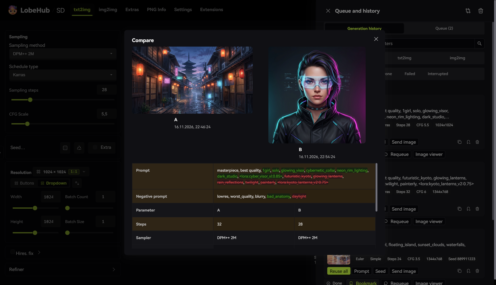
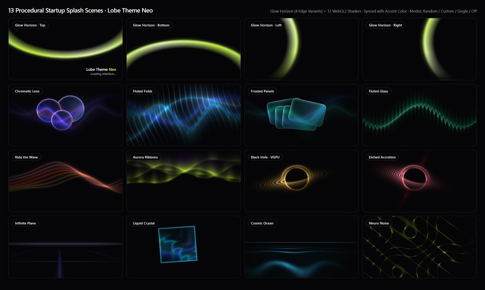

<div align="center">


# Lobe Theme Neo

**Современная, глубоко настраиваемая тема рабочего пространства с набором встроенных инструментов для Stable Diffusion WebUI Forge Neo**

[](./package.json)
[](https://github.com/Haoming02/sd-webui-forge-classic/tree/neo)
[](./package.json)
[](./package.json)
[](#-языки-и-встроенные-шрифты)
[](./LICENSE)

[English](./README.md) · [Русский](./README.ru-RU.md) · [简体中文](./README.zh-CN.md)

<br />


*Тёмная тема (нейтральная палитра `OLED` · акцент `Lime`) · Пресет `1. Classic`*

</div>

---

## ✨ Главные особенности и пресеты макета

**Lobe Theme Neo** превращает **Stable Diffusion WebUI Forge Neo (Gradio 4.x)** в современную студию на базе **React 19**, **Ant Design 6**, **@lobehub/ui v6**, **TypeScript** и контурных SVG-иконок **Tabler**. Во всех пресетах кнопка `Generate` и очередь размещены сверху для мгновенного запуска, а расширение включает готовые инструменты продуктивности «из коробки»: встроенную очередь генераций на SQLite, историю с визуальным A/B-сравнением, **Memory Keeper** для управления VRAM/RAM, подсветку синтаксиса промптов с автодополнением Danbooru/Gelbooru и Dynamic Prompts, drag-and-drop редактор макетов и 13 процедурных сплэш-экранов запуска.

<table>
  <tr>
    <td width="50%" valign="top">
      <a href="./docs/assets/hero-dark-inference.png">
        
      </a>
      <p align="center"><b>Тёмная · OLED + Lime · 2. Инференс (3 колонки)</b><br /><sub>Параллельные колонки параметров, промпта и превью с живой очередью и 2×2 Sampling</sub></p>
    </td>
    <td width="50%" valign="top">
      <a href="./docs/assets/preview-light-studio.png">
        
      </a>
      <p align="center"><b>Светлая · Nord + Sky · 1. Классический Split</b><br /><sub>Светлая тема без перезагрузки, быстрые кнопки пропорций и единые вкладки Extra Network</sub></p>
    </td>
  </tr>
  <tr>
    <td colspan="2" align="center" valign="top">
      <a href="./docs/assets/preview-studio-focus.png">
        
      </a>
      <p align="center"><b>Тёмная · Kitchen + Lime · 3. Студия / Фокус</b><br /><sub>Компактный блок промпта и Generate над широким превью с кнопкой выдвижной панели параметров</sub></p>
    </td>
  </tr>
</table>

---

## 🎨 Глубокая визуальная настройка и панель параметров

Любой элемент интерфейса — палитры, яркость поверхностей, скругления, отступы, макет, шрифты и логотип — настраивается в реальном времени, а всю конфигурацию можно сохранить или перенести через **Экспорт / Импорт JSON**.

### Движок цветов, материалы поверхностей и CIELAB-яркость


- **Авто / Светлая / Тёмная тема**: мгновенное переключение в шапке без перезагрузки страницы или автоматическая синхронизация с системой.
- **24 акцентных цвета**: канонический `Lime`, `Crimson`, `Kitchen` (фирменный тёпло-оранжевый), `Amber`, `Gold`, `Emerald`, `Teal`, `Cyan`, `Sky`, `Blue`, `Indigo`, `Violet`, `Purple`, `Pink`, `Rose` и строгий `Mono` с расчётом высококонтрастного текста (`--lobe-primary-contrast` / `--lobe-accent-text`).
- **12 нейтральных палитр поверхностей**: продуманные тоновые системы `Default`, `OLED` (чистый чёрный), `Kitchen`, `Zinc`, `Slate`, `Nord`, `Twilight`, `Mauve`, `Rosewood`, `Espresso`, `Sand` и `Sage`.
- **CIELAB-яркость темы (`-30%` … `+30%`)**: равномерная для человеческого глаза коррекция светлоты с шагом 5%, сохраняющая контраст текста и рамок.
- **Поверхности, углы и плотность**: режимы `Flat`, `Glass` (полупрозрачное стекло с лёгким размытием) и `Elevated`; углы `Round`, `Soft`, `Sharp`; плотность `Comfortable` или `Compact`.
- **Свой логотип, Favicon и SVG-иконки Tabler**: установка изображения по URL / Base64 / эмодзи с синхронной генерацией PNG-фавиконки на Canvas и заменой эмодзи WebUI на чёткие **SVG-иконки Tabler**.
- **Прогресс-бар и анимация рамки результата**: градиентный прогресс-бар `Aurora` со счётчиком шагов и ETA или `Classic`, а также эффекты рамки результата (`Glow edge`, `Pulse`, `Ambient`, `Scan`, `Orbit`).

### Гибкое рабочее пространство


- **3 встроенных пресета компоновки**:
  1. **Classic**: адаптивный двухзонный с параметрами рядом с предпросмотром.
  2. **Inference (Мультиколонка)**: 3 параллельные колонки (`Параметры | Промпт | Превью` или `Превью | Промпт | Параметры`) либо 2-колоночный Cockpit для работы без скроллинга на широких мониторах.
  3. **Studio / Focus**: центрированное широкое превью под компактной верхней зоной «Промпт + Generate» с выдвижной панелью параметров.
- **Сортировка блоков и профили**: меняйте порядок и скрывайте неиспользуемые аккордеоны (`Sampling`, `Seed`, `Resolution`, `Hires. fix`, `Refiner`, расширения) отдельно для `txt2img` и `img2img`, задавайте высоту полей промпта и сохраняйте до **8 именованных профилей**.
- **Боковые панели**: закрепляйте (`Fixed`) или делайте плавающими (`Float`) левую панель **Быстрых настроек** (`Настройки | Пресеты`) и правую панель **Extra Networks**, регулируйте ширину и размер карточек (`64 px – 256 px`).

### Обзор вкладок панели настроек


Каждый модуль вынесен на отдельную вкладку **Theme Settings** (`Внешний вид`, `Макет`, `Разрешение и пропорции`, `Промпт`, `Автодополнение`, `Очередь`, `Боковые панели`, `Экспериментальные`) с поддержкой **JSON Экспорта / Импорта** и безопасным применением настроек по кнопке **Применить**.

---

## 🚀 Встроенные инструменты продуктивности

### Студия промптов, подсветка синтаксиса и автодополнение тегов


- **Панель работы с промптом (Prompt Workbench)**: сворачиваемые секции для `Styles`, `Dynamic Prompts` и `Подбора тегов` в сочетании с унифицированной панелью быстрых кнопок (вставка параметров, очистка, копирование, форматтер, отмена/повтор, разбиение по секциям).
- **Секции промпта (Prompt Sections)**: автоматическое разбиение по `BREAK` на отдельные карточки с цветовыми метками и подсчётом токенов в каждой секции.
- **Гибкая подсветка синтаксиса**: раздельное включение расцветки для **категорий тегов Danbooru / e621**, **моделей `<lora:...>`**, **весов и скобок** `(tag:1.2)`, **вайлдкардов** `__path/name__` и **операторов `BREAK` / `AND`**.
- **Встроенные автодополнение и Dynamic Prompts**:
  - В поставку уже включены **словари Danbooru и Gelbooru**, **английский словарь**, **шаблоны Chants** и **1 702 файла вайлдкардов** (`assets/wildcards/`) с отдельной вкладкой управления (`scripts/dynamic_prompts.py`).
  - **Фильтрация LoRA по архитектуре и триггер-слова**: приоритизация совместимых LoRA под текущий чекпоинт (`SDXL`, `Flux`, `Illustrious`, `SD 1.5`, `Pony`, `SD 3` и др.), автоподстановка activation text и `@artist` для ANIMA.
  - **Сортировка по частоте использования и форматтер промптов**: локальная SQLite-база частоты тегов, приглушение уже введённых тегов (`🔁`) и форматирование с предпросмотром diff (`Alt+Shift+F` или при потере фокуса).

### Очередь генерации, история и A/B-сравнение



- **Встроенная очередь генерации**: комбинированная кнопка `В очередь ▾` (`Ctrl/Cmd+Shift+Enter`) и виджет активных задач прямо под `Generate` (пауза, возобновление, изменение приоритета, импорт/экспорт в JSON и автоматическая миграция задач из `agent-scheduler-neo`).
- **Пакетная генерация по чекпоинтам и действия по завершении**: добавление заданий для текущего чекпоинта, выбранных моделей, всей папки или всех чекпоинтов; автодействие после очереди (`Ничего`, `Сон`, `Гибернация`, `Выключить ПК`, `Остановить WebUI`).
- **История генераций и A/B-сравнение**: до **2 000 записей** с миниатюрами в `lobe_data/theme.sqlite3`, полнотекстовый поиск, закладки, кнопки `Повторить всё` / `Промпт` / `Сид`, `Сохранить как пресет`, **лента результатов с Lightbox** (`←` / `→` / `Esc`) и **A/B-сравнение двух генераций** с подсветкой отличий `TokenDiff` в промпте и параметрах.

### Memory Keeper, мониторинг железа и палитра команд


- **Memory Keeper**: наглядные шкалы VRAM и RAM с разбивкой на **WebUI**, **подпроцессы** и **другие приложения**. Раскройте **Подробности** (`>`), чтобы увидеть загруженные `Checkpoint` (с разбивкой на UNet / Text Encoder / VAE) и `LoRA`: закрепляйте модели (`🔒 Удерживать` между перезапусками), выгружайте компоненты `→ RAM`, очищайте VRAM/RAM по разделам и меняйте `VRAM Mode` (`High` / `Normal` / `Low`) на лету.
- **Монитор ресурсов**: живые графики загрузки CPU, RAM, GPU, VRAM, температуры, энергопотребления (NVML) и занятости диска.
- **Палитра команд (`Ctrl+K` / `⌘K`)** и **поиск вкладок**: быстрый нечёткий поиск действий (`Генерировать`, `Прервать`, пресеты, сэмплеры, планировщики, чекпоинты, LoRA, история, настройки, вкладки) + поповер «Все вкладки» с закреплением нужных табов.

### 13 процедурных сплэш-экранов запуска



- Убирает белую вспышку до загрузки Gradio, отображая один из **13 сплэш-экранов**: CSS-сцену **Glow Horizon** в **4 вариантах появления** (`Top`, `Bottom`, `Left`, `Right`) и **12 живых WebGL2-шейдеров** (`Chromatic Lens`, `Fluted Folds`, `Frosted Panels`, `Fluted Glass`, `Ride the Wave`, `Aurora Ribbons`, `Black Hole · VGPU`, `Etched Accretion`, `Infinite Plane`, `Liquid Crystal`, `Cosmic Ocean`, `Neuro Noise`).
- Все сцены автоматически подстраиваются под ваш текущий акцентный цвет и поддерживают режимы **Случайная**, **Выборочный набор**, **Одна сцена** или **Откл.**.

---

## 🛠️ Дополнительные встроенные фишки

- **Инструменты карточек LoRA**: кнопки веса (`−` / значение / `+` и изменение колёсиком мыши прямо на карточке с обновлением промпта), избранное (`★`), фильтры (`Все`, `Избранные`, `Недавние`, `Совместимые`), вставка триггер-слов и бейджи совместимости с архитектурой чекпоинта (`XL`, `Flux` и др.).
- **Панель соотношений сторон и разрешений**: переключение между компактным `Выпадающим списком` и сеткой `Кнопок` (`SDXL/Flux`, `SD 2.x`, `SD 1.5`, `Wan`), кнопка инверсии `⇄`, пропорциональная блокировка сторон Ratio Lock, подсказки рекомендованных настроек модели, сетка **Sampling 2×2** и генератор **Chaotic Seed**.
- **Безопасная загрузка Safetensors на Windows**: встроенный патч `safetensors_compat.py` включает `backend="pread"` для стабильной загрузки моделей крупнее 4 ГБ без ошибок `mmap`.
- **Пресеты параметров**: сохранение наборов настроек (с опциональным сохранением Seed и размера батча) прямо в левой панели.

---

## 🌐 Языки и встроенные шрифты


- **11 встроенных языков**: `English (en_US)`, `Русский (ru_RU)`, `简体中文 (zh_CN)`, `繁體中文 (zh_HK)`, `日本語 (ja_JP)`, `한국어 (ko_KR)`, `Deutsch (de_DE)`, `Español (es_ES)`, `Français (fr_FR)`, `Português (pt_BR)`, `Türkçe (tr_TR)`, а также двусторонняя синхронизация с нативными локализациями Forge и расширением `sd-webui-language-diffusion`.
- **100% офлайн-шрифты**: интерфейсные шрифты (`HarmonyOS Sans`, `Inter`, `Geist`, `System UI`) и моноширинные для промптов (`Hack`, `Geist Mono`, `System`) встроены в `assets/fonts/` и работают без интернета и внешних CDN.

---

## 🧩 Совместимость и экосистема

| Компонент / Расширение | Статус | Примечание |
| --- | --- | --- |
| **Forge Neo (Gradio 4.x)** | ✅ Нативная | Создано специально под DOM, компоненты Gradio 4 и пресеты Forge Neo |
| **Встроенное автодополнение тегов** | ✅ Из коробки | Автоматически уступает управление внешнему `a1111-sd-webui-tagcomplete`, если он установлен |
| **Встроенный Dynamic Prompts** | ✅ Из коробки | Подключает скрипт и менеджер вайлдкардов (`assets/wildcards/`), если внешний DP отсутствует |
| **Встроенная очередь генераций** | ✅ Из коробки | Автоматически переносит историю и задания из SQLite-базы `agent-scheduler-neo` |
| **Внешние расширения (ADetailer / ControlNet / TIPO)** | 🔌 Опциональная интеграция | Автоматически стилизуются токенами темы и Tabler SVG-иконками, если установлены пользователем отдельно |
| **SD WebUI 1.x / A1111 (Gradio 3)** | ⚠️ Не поддерживается | Для классического Gradio 3 используйте оригинальный [`lobehub/sd-webui-lobe-theme`](https://github.com/lobehub/sd-webui-lobe-theme) |

<details>
<summary><b>⌨️ Горячие клавиши</b></summary>

| Комбинация | Действие |
| --- | --- |
| `Ctrl+K` / `⌘K` | Открыть **Палитру команд** |
| `Ctrl+Enter` / `⌘Enter` | Запустить генерацию |
| `Ctrl+Shift+Enter` / `⌘Shift+Enter` | Поставить промпт в **Очередь генерации** |
| `Alt+Shift+F` | Форматировать промпт с **предпросмотром diff** |
| `←` / `→` / `Esc` | Навигация и закрытие **Lightbox результатов** / окна сравнения |

</details>

---

## 📦 Установка и обновление

### Способ 1: Через интерфейс Forge Neo (Рекомендуется)

> Готовая продакшн-сборка фронтенда (`javascript/main.mjs` и `javascript/chunks/*`) уже включена в репозиторий — установка Node.js не требуется.

1. Откройте **Stable Diffusion WebUI Forge Neo**.
2. Перейдите во вкладку **Extensions → Install from URL**.
3. Вставьте ссылку и нажмите **Install**:
   ```text
   https://github.com/LeonWGal/lobe-theme-neo
   ```
4. Перейдите в **Extensions → Installed**, нажмите **Check for updates**, затем **Apply and restart UI**.

### Способ 2: Клонирование через Git

```bash
cd path/to/sd-webui-forge-neo/extensions
git clone https://github.com/LeonWGal/lobe-theme-neo.git
```

Полностью перезапустите Forge Neo через лаунчер, чтобы на старте зарегистрировались `preload.py` и Python-маршруты `/lobe/*`.

> [!NOTE]
> Пользовательский конфиг (`lobe_theme_config.json`) и локальные базы данных (`lobe_data/theme.sqlite3`, база частоты тегов) добавлены в `.gitignore` и не затираются при обновлениях через Git.

---

## 🧑‍💻 Разработка и сборка

Стек проекта: **React 19**, **Ant Design 6**, **@lobehub/ui v6**, **antd-style**, **Zustand**, **Vite 5**, **TypeScript** и **Python**.

### Фронтенд

```bash
npm install

# Режим разработки (Vite dev server)
npm run dev

# Сборка продакшн-бандла в javascript/main.mjs и javascript/chunks/
npm run build

# Проверка ESLint и типов TypeScript
npm run ci

# Юнит-тесты Vitest
npm test
```

### Тесты Python-бэкенда

Запускайте в виртуальном окружении Forge Neo:

```bash
python -B -m unittest discover -s tests -p "test_*.py" -v
```

### Структура репозитория

```text
lobe-theme-neo/
├── assets/
│   ├── autocomplete/       # Встроенные словари Danbooru/Gelbooru/English, chants и JS-движок
│   ├── boot/               # WebGL2-шейдеры экранов запуска (scenes.mjs)
│   ├── fonts/              # Офлайн-шрифты HarmonyOS Sans, Inter, Geist, Hack, Mono
│   └── wildcards/          # 1 702 шаблона вайлдкардов
├── docs/assets/            # Скриншоты интерфейса для README
├── javascript/             # Предсобранный Vite-бандл и мосты (aspect_ratio, boot, queue)
├── locales/                # 11 языковых файлов локализации + options.json
├── scripts/                # FastAPI-роуты, SQLite очереди/истории, Memory Keeper, DP и pread-патч
├── src/                    # Исходный код UI на React 19 / TypeScript
└── tests/                  # Наборы тестов Vitest и Python unittest
```

---

## 🙏 Благодарности и лицензия

- Основано на **[sd-webui-lobe-theme](https://github.com/lobehub/sd-webui-lobe-theme)** от **LobeHub** — расширено, перенесено на Gradio 4.x / React 19 / Ant Design 6 и пересобрано специально для Forge Neo.
- Встроенное автодополнение и вайлдкарды адаптированы из `a1111-sd-webui-tagcomplete` / `sd-webui-tagcomplete-neo` и `sd-dynamic-prompts`.
- Распространяется под лицензией **GNU Affero General Public License v3.0 ([AGPL-3.0](./LICENSE))**.
