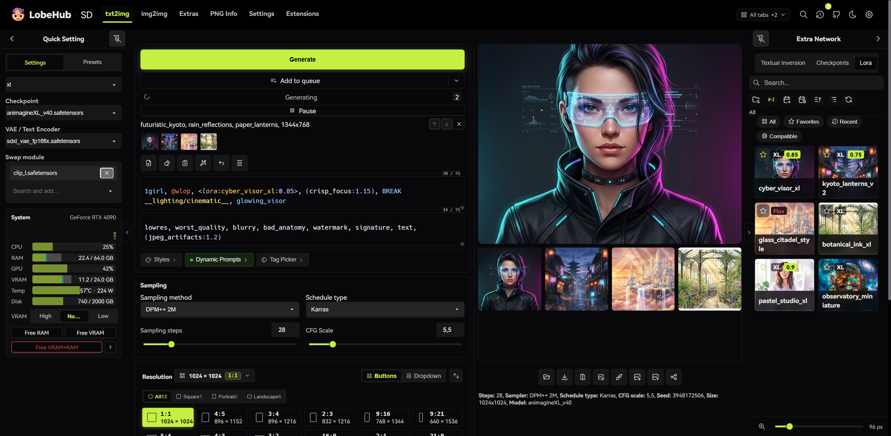
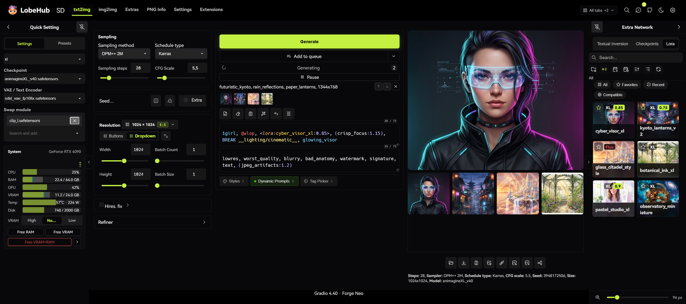
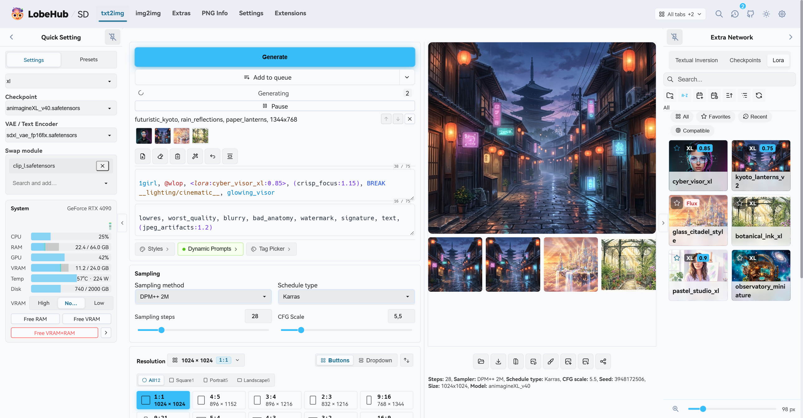
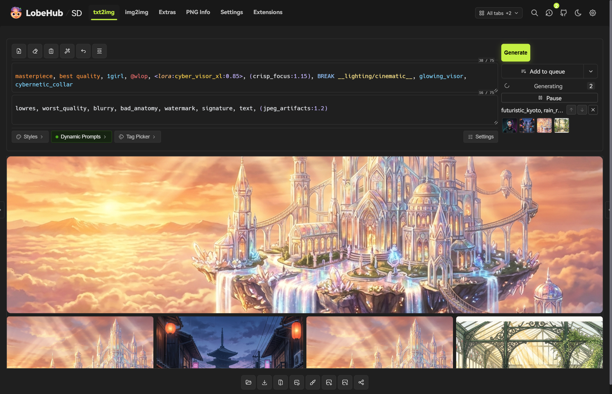
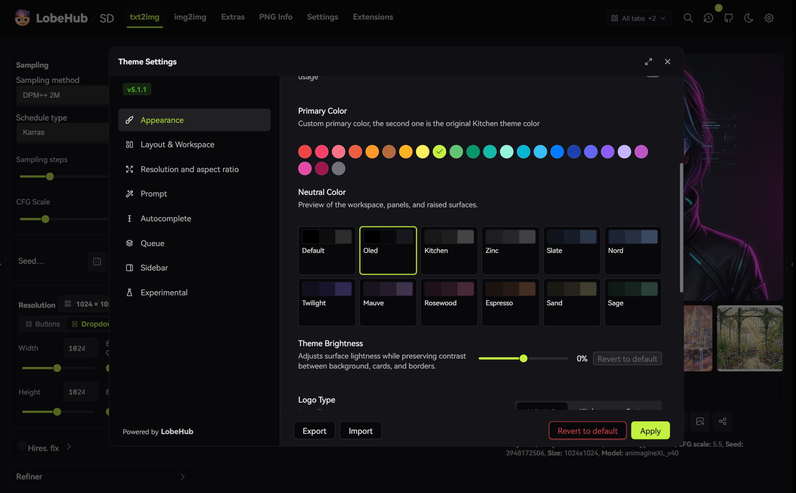
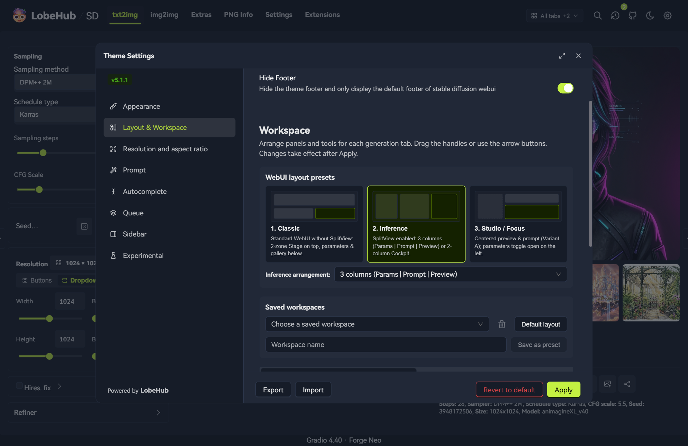
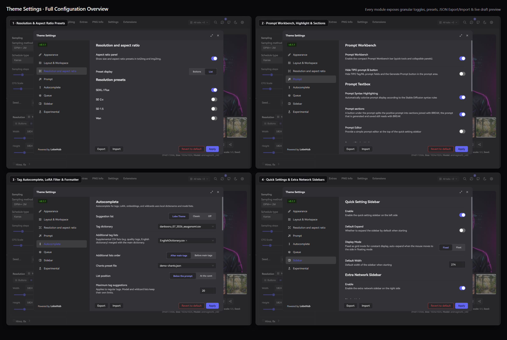
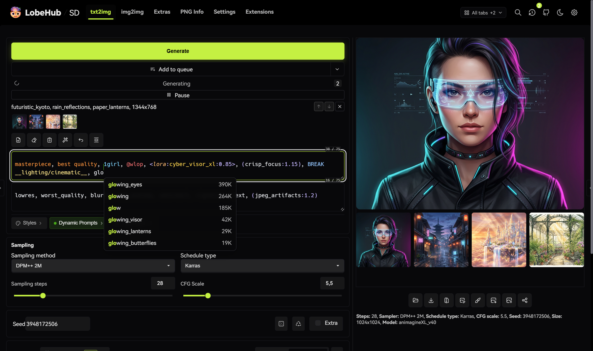
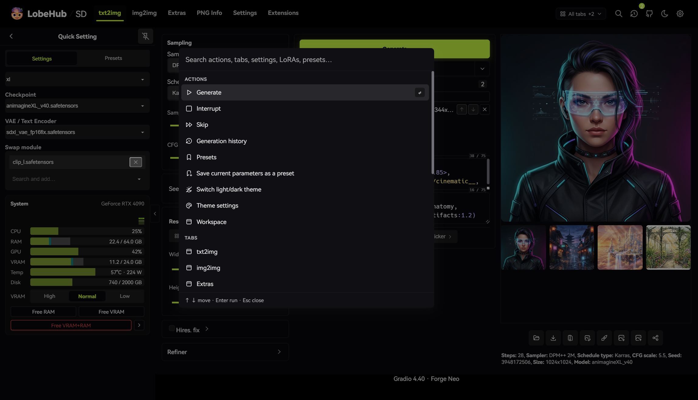
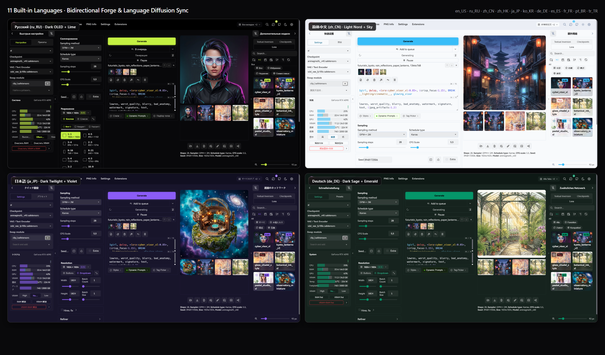

<div align="center">

# Lobe Theme Neo

Тема рабочего пространства и набор встроенных инструментов для Stable Diffusion WebUI Forge Neo

[](./package.json)
[](https://github.com/Haoming02/sd-webui-forge-classic/tree/neo)
[](./package.json)
[](./package.json)
[](#языки-и-шрифты)
[](./LICENSE)

[English](./README.md) · [Русский](./README.ru-RU.md) · [简体中文](./README.zh-CN.md)

<br />



*Тёмная тема (нейтральная палитра `OLED`, акцент `Lime`), пресет `1. Classic`*

</div>

---

## Обзор и пресеты макета

Lobe Theme Neo переносит интерфейс Stable Diffusion WebUI Forge Neo (Gradio 4.x) на React 19, Ant Design 6, @lobehub/ui v6 и TypeScript, а стандартные эмодзи WebUI заменяет на контурные SVG-иконки Tabler. Кроме оформления, в расширение встроены очередь генерации на SQLite, история с A/B-сравнением, панель памяти Memory Keeper, редактор промптов с подсветкой и автодополнением, настройка макета и 13 сплэш-экранов запуска.

<table>
  <tr>
    <td width="50%" valign="top">
      <a href="./docs/assets/hero-dark-inference.png">
        
      </a>
      <p align="center"><b>Тёмная · OLED + Lime · 2. Инференс (3 колонки)</b><br /><sub>Колонки параметров, промпта и превью с очередью и сеткой Sampling 2×2</sub></p>
    </td>
    <td width="50%" valign="top">
      <a href="./docs/assets/preview-light-studio.png">
        
      </a>
      <p align="center"><b>Светлая · Nord + Sky · 1. Classic</b><br /><sub>Светлая тема с кнопками соотношений сторон и вкладками Extra Networks</sub></p>
    </td>
  </tr>
  <tr>
    <td colspan="2" align="center" valign="top">
      <a href="./docs/assets/preview-studio-focus.png">
        
      </a>
      <p align="center"><b>Тёмная · Kitchen + Lime · 3. Studio / Focus</b><br /><sub>Верхний блок промпта с Generate, центрированное превью и выдвижная панель настроек</sub></p>
    </td>
  </tr>
</table>

---

## Настройка интерфейса и макета

Цвета, яркость поверхностей, скругления, плотность элементов, логотип и раскладка меняются без перезагрузки страницы, а настройки можно переносить через Export / Import в JSON.

### Цвета, поверхности и яркость



- **Тема оформления:** переключение `Auto`, `Light` и `Dark` в верхней панели или синхронизация с темой ОС.
- **24 акцентных цвета:** `Lime`, `Crimson`, `Kitchen`, `Amber`, `Gold`, `Emerald`, `Teal`, `Cyan`, `Sky`, `Blue`, `Indigo`, `Violet`, `Purple`, `Pink`, `Rose`, `Mono` и другие. Текст на кнопках и подсветке автоматически подбирает контрастный цвет.
- **12 нейтральных палитр:** `Default`, `OLED`, `Kitchen`, `Zinc`, `Slate`, `Nord`, `Twilight`, `Mauve`, `Rosewood`, `Espresso`, `Sand` и `Sage`.
- **Яркость по CIELAB (от `-30%` до `+30%`):** регулировка светлоты поверхностей с шагом 5% без потери контраста между текстом и рамками.
- **Материалы, углы и плотность:** `Flat`, `Glass` (полупрозрачность с blur) и `Elevated`; углы `Round`, `Soft`, `Sharp`; плотность `Comfortable` или `Compact`.
- **Логотип, фавиконка и иконки:** свой логотип по URL, Base64 или тексту с синхронной генерацией PNG-фавиконки, плюс замена эмодзи WebUI на иконки Tabler.
- **Индикатор прогресса и рамка результата:** прогресс-бар `Aurora` со счётчиком шагов и ETA или `Classic`, эффекты рамки `Glow edge`, `Pulse`, `Ambient`, `Scan` и `Orbit`.

### Гибкое рабочее пространство



- **3 пресета компоновки:**
  1. **Classic:** две зоны с параметрами слева и предпросмотром справа.
  2. **Inference (Мультиколонка):** 3 колонки (`Параметры | Промпт | Превью` или `Превью | Промпт | Параметры`) или 2-колоночный Cockpit для широких экранов.
  3. **Studio / Focus:** широкое превью под строкой промпта и `Generate`, параметры открываются по кнопке.
- **Сортировка блоков и профили:** перетаскивание и скрытие аккордеонов (`Sampling`, `Seed`, `Resolution`, `Hires. fix`, `Refiner`, расширений) отдельно для `txt2img` и `img2img`, настройка высоты промпта и до 8 сохранённых профилей.
- **Боковые панели:** режимы `Fixed` и `Float` для левой панели «Быстрые настройки» (`Настройки | Пресеты`) и правой панели `Extra Networks`, перетягиваемая ширина и размер карточек от 64 px до 256 px.

### Панель настроек



Параметры каждого модуля собраны во вкладках **Theme Settings**: «Внешний вид», «Макет и рабочее пространство», «Разрешение и пропорции», «Промпт», «Автодополнение», «Очередь», «Боковые панели» и «Экспериментальные». Изменения работают в черновике и применяются кнопкой `Apply`.

---

## Встроенные инструменты

### Промпт, подсветка синтаксиса и автодополнение тегов



- **Prompt Workbench:** сворачиваемые секции `Styles`, `Dynamic Prompts` и «Подбор тегов», плюс панель действий над промптом (чтение параметров, очистка, копирование, форматирование, отмена/повтор и секции).
- **Секции промпта:** разбиение текста по `BREAK` на отдельные карточки с подсчётом токенов в каждой секции.
- **Подсветка синтаксиса:** отдельные переключатели цвета для категорий тегов Danbooru / e621, моделей `<lora:...>`, весов и скобок `(tag:1.2)`, вайлдкардов `__path/name__` и операторов `BREAK` / `AND`.
- **Автодополнение и Dynamic Prompts:**
  - В комплект входят словари Danbooru и Gelbooru, английский словарь, наборы Chants и 1 702 файла вайлдкардов (`assets/wildcards/`) со вкладкой управления (`scripts/dynamic_prompts.py`).
  - Автодополнение `<lora:...>` учитывает семейство активного чекпоинта (`SDXL`, `Flux`, `Illustrious`, `SD 1.5`, `Pony`, `SD 3` и др.), умеет подставлять триггер-слова и префикс `@artist` для ANIMA.
  - Сортировка подсказок по частоте использования через локальную SQLite-БД, приглушение уже добавленных в промпт тегов и форматирование с предпросмотром изменений (`Alt+Shift+F` или при потере фокуса).

### Очередь генерации, история и A/B-сравнение


- **Встроенная очередь:** кнопка `Add to queue` (`Ctrl/Cmd+Shift+Enter`) и список текущих задач под `Generate` с паузой, изменением приоритета, импортом/экспортом в JSON и автоматическим переносом данных из `agent-scheduler-neo`.
- **Пакетный запуск и завершение:** постановка задач по текущему чекпоинту, списку выбранных моделей, папке или всем чекпоинтам. После завершения очереди можно задать действие: ничего, сон, гибернация, выключение ПК или остановка WebUI.
- **История и A/B-сравнение:** до 2 000 генераций с миниатюрами в `lobe_data/theme.sqlite3`, поиск, закладки, кнопки `Повторить всё` / `Промпт` / `Сид`, сохранение в пресет, лента результатов с просмотрщиком (`Left` / `Right` / `Esc`) и окно сравнения двух изображений с `TokenDiff` для промпта и параметров.

### Memory Keeper, мониторинг ресурсов и палитра команд



- **Memory Keeper:** шкалы VRAM и RAM с делением на WebUI, подпроцессы и прочие программы. В раскрытой секции деталей видны загруженные чекпоинты (по частям UNet, Text Encoder, VAE) и LoRA: их можно закрепить (`Keep` между перезапусками), перенести в RAM, выгрузить или сменить `VRAM Mode` (`High` / `Normal` / `Low`) без перезапуска WebUI.
- **Монитор ресурсов:** показания CPU, RAM, нагрузки GPU, VRAM, температуры, энергопотребления (NVML) и занятости диска.
- **Палитра команд (`Ctrl+K` / `⌘K`):** поиск действий (`Generate`, `Interrupt`, `Skip`, пресеты, сэмплеры, планировщики, чекпоинты, LoRA, недавняя история, настройки, вкладки) и отдельное меню «Все вкладки» с закреплением табов.

### Сплэш-экраны запуска


До инициализации Gradio экран скрывает белую вспышку одной из 13 процедурных сцен: CSS-сценой **Glow Horizon** в 4 вариантах ориентации (`Top`, `Bottom`, `Left`, `Right`) и 12 WebGL2-шейдерами (`Chromatic Lens`, `Fluted Folds`, `Frosted Panels`, `Fluted Glass`, `Ride the Wave`, `Aurora Ribbons`, `Black Hole · VGPU`, `Etched Accretion`, `Infinite Plane`, `Liquid Crystal`, `Cosmic Ocean`, `Neuro Noise`). Цвет сцен привязан к текущему акценту, поддерживаются режимы `Random`, `Custom`, `Single` и `Off`.

---

## Дополнительные возможности

- **Карточки LoRA:** изменение веса (`−` / значение / `+` и колесом мыши с обновлением тега в промпте), избранное, фильтры (`All`, `Favorites`, `Recent`, `Compatible`), вставка триггер-слов и бейджи архитектуры (`XL`, `Flux` и т.д.).
- **Панель разрешений и соотношений сторон:** выбор между выпадающим списком и сеткой кнопок (`SDXL/Flux`, `SD 2.x`, `SD 1.5`, `Wan`), инверсия сторон `⇄`, блокировка пропорций Ratio Lock, подсказки рекомендованных параметров модели, сетка Sampling 2×2 и генератор Chaotic Seed.
- **Загрузка Safetensors на Windows:** встроенный патч `safetensors_compat.py` использует `backend="pread"` для стабильной загрузки файлов крупнее 4 ГБ без ошибок `mmap`.
- **Пресеты параметров:** сохранение сэмплера, шагов, CFG, разрешения и опционально сида или батча в левой панели.

---

## Языки и шрифты



- **11 языков интерфейса:** `English (en_US)`, `Русский (ru_RU)`, `简体中文 (zh_CN)`, `繁體中文 (zh_HK)`, `日本語 (ja_JP)`, `한국어 (ko_KR)`, `Deutsch (de_DE)`, `Español (es_ES)`, `Français (fr_FR)`, `Português (pt_BR)`, `Türkçe (tr_TR)`. Поддерживается двусторонняя синхронизация с локализациями Forge и `sd-webui-language-diffusion`.
- **Офлайн-шрифты:** UI-шрифты (`HarmonyOS Sans`, `Inter`, `Geist`, `System UI`) и моноширинные шрифты (`Hack`, `Geist Mono`, `System UI`) хранятся локально в `assets/fonts/` и не зависят от внешних CDN.

---

## Совместимость и горячие клавиши

| Компонент / Расширение | Статус | Примечание |
| --- | --- | --- |
| **Forge Neo (Gradio 4.x)** | Нативная поддержка | Написано под DOM, компоненты Gradio 4 и пресеты Forge Neo |
| **Встроенное автодополнение тегов** | Включено в состав | Уступает управление внешнему `a1111-sd-webui-tagcomplete`, если он установлен |
| **Встроенный Dynamic Prompts** | Включено в состав | Подключает скрипт и менеджер вайлдкардов (`assets/wildcards/`), если внешний DP не установлен |
| **Встроенная очередь генераций** | Включено в состав | Автоматически переносит задачи и историю из SQLite-БД `agent-scheduler-neo` |
| **ADetailer / ControlNet / TIPO** | Опциональная интеграция | Стилизуются темой и иконками Tabler только при наличии этих расширений у пользователя |
| **SD WebUI 1.x / A1111 (Gradio 3)** | Не поддерживается | Для классического Gradio 3 используйте [`lobehub/sd-webui-lobe-theme`](https://github.com/lobehub/sd-webui-lobe-theme) |

<details>
<summary><b>Горячие клавиши</b></summary>

| Комбинация | Действие |
| --- | --- |
| `Ctrl+K` / `⌘K` | Открыть палитру команд |
| `Ctrl+Enter` / `⌘Enter` | Запустить генерацию |
| `Ctrl+Shift+Enter` / `⌘Shift+Enter` | Добавить текущий промпт в очередь |
| `Alt+Shift+F` | Форматировать промпт с предпросмотром diff |
| `←` / `→` / `Esc` | Листать и закрывать просмотрщик результатов или A/B-сравнение |

</details>

---

## Установка и обновление

### Через интерфейс Forge Neo (рекомендуется)

> Собранный фронтенд (`javascript/main.mjs` и `javascript/chunks/*`) уже включён в репозиторий, Node.js устанавливать не нужно.

1. Откройте Stable Diffusion WebUI Forge Neo.
2. Перейдите в **Extensions → Install from URL**.
3. Вставьте адрес репозитория и нажмите **Install**:
   ```text
   https://github.com/LeonWGal/lobe-theme-neo
   ```
4. В разделе **Extensions → Installed** нажмите **Check for updates**, затем **Apply and restart UI**.

### Через Git

```bash
cd path/to/sd-webui-forge-neo/extensions
git clone https://github.com/LeonWGal/lobe-theme-neo.git
```

Перезапустите Forge Neo целиком через лаунчер, чтобы на старте зарегистрировались `preload.py` и маршруты `/lobe/*`.

> [!NOTE]
> Пользовательский файл `lobe_theme_config.json` и базы данных в `lobe_data/` добавлены в `.gitignore`, поэтому обновления через Git не сбрасывают ваши настройки и историю.

---

## Разработка и тесты

Стек: React 19, Ant Design 6, @lobehub/ui v6, antd-style, Zustand, Vite 5, TypeScript, Python.

### Фронтенд

```bash
npm install

# Локальный dev-сервер Vite
npm run dev

# Сборка продакшн-бандла в javascript/main.mjs и javascript/chunks/
npm run build

# Проверка ESLint и TypeScript
npm run ci

# Юнит-тесты Vitest
npm test
```

### Тесты Python

Запускаются в виртуальном окружении Forge Neo:

```bash
python -B -m unittest discover -s tests -p "test_*.py" -v
```

### Структура репозитория

```text
lobe-theme-neo/
├── assets/
│   ├── autocomplete/       # Словари Danbooru/Gelbooru/English, chants и движок JS
│   ├── boot/               # WebGL2-шейдеры сцен запуска (scenes.mjs)
│   ├── fonts/              # Локальные веб-шрифты HarmonyOS Sans, Inter, Geist, Hack, Mono
│   └── wildcards/          # 1 702 файла вайлдкардов
├── docs/assets/            # Скриншоты для README
├── javascript/             # Предсобранный Vite-бандл и мосты (aspect_ratio, boot, queue)
├── locales/                # 11 языковых файлов локализации + options.json
├── scripts/                # FastAPI-роуты, SQLite очереди/истории, Memory Keeper, DP и pread-патч
├── src/                    # Исходный код интерфейса на React 19 / TypeScript
└── tests/                  # Тесты Vitest и Python unittest
```

---

## Благодарности и лицензия

- Основано на [sd-webui-lobe-theme](https://github.com/lobehub/sd-webui-lobe-theme) от LobeHub, перенесено на Gradio 4.x / React 19 / Ant Design 6 и переработано под Forge Neo.
- Встроенное автодополнение тегов и вайлдкарды адаптированы из `a1111-sd-webui-tagcomplete` / `sd-webui-tagcomplete-neo` и `sd-dynamic-prompts`.
- Лицензия: GNU Affero General Public License v3.0 ([AGPL-3.0](./LICENSE)).
