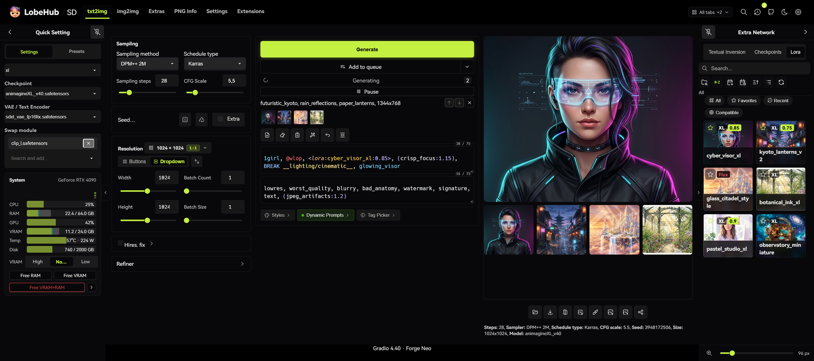
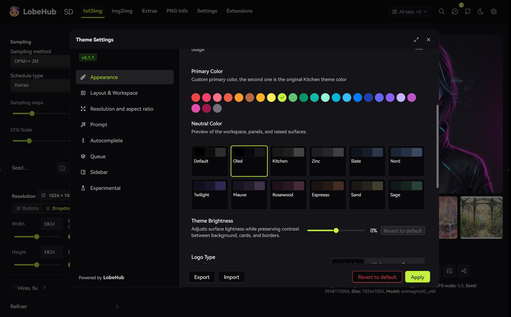
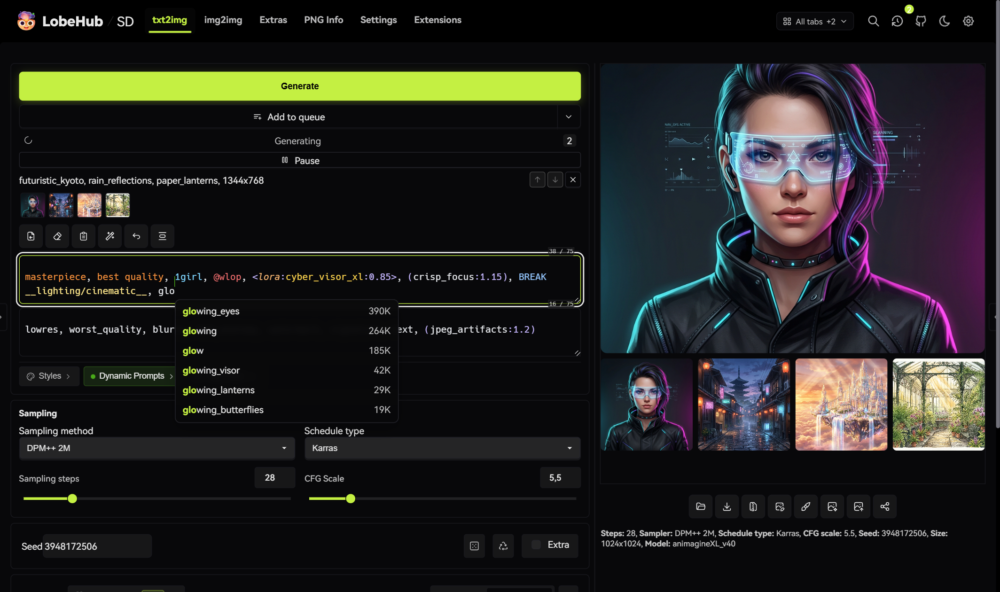
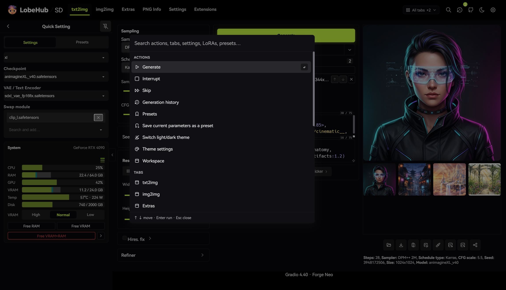

<div align="center">


# Lobe Theme Neo

**专为 Stable Diffusion WebUI Forge Neo 打造的现代、高自由度可定制工作区主题与效率套件**

[](./package.json)
[](https://github.com/Haoming02/sd-webui-forge-classic/tree/neo)
[](./package.json)
[](./package.json)
[](#-国际化与内置字体)
[](./LICENSE)

[English](./README.md) · [Русский](./README.ru-RU.md) · [简体中文](./README.zh-CN.md)

<br />


*深色模式（`OLED` 中性色板 · 经典 `Lime` 强调色） · 「1. Classic」经典分栏预设（顶部 `Generate` 与快捷比例按钮） · 固定式快速设置、系统监控与 Extra Networks 侧边栏*

</div>

---

## ✨ 核心亮点与布局预设

**Lobe Theme Neo** 基于 **React 19**、**Ant Design 6**、**@lobehub/ui v6**、**TypeScript** 与 **Tabler 线性 SVG 图标**，为 **Stable Diffusion WebUI Forge Neo (Gradio 4.x)** 带来全新创作工作台体验。所有内置工作区预设均将 `Generate` 与入队操作置于上方，方便高频点击；同时开箱集成 SQLite 生成队列、历史记录可视化 A/B 对比、显存/内存管家 **Memory Keeper**、提示词语法高亮与内置 Danbooru/Gelbooru 标签补全、拖拽式工作区布局以及 13 款 WebGL2 程序化启动动画。

<table>
  <tr>
    <td width="50%" valign="top">
      <a href="./docs/assets/hero-dark-inference.png">
        
      </a>
      <p align="center"><b>深色 · OLED + Lime · 2. Inference（三栏推理）</b><br /><sub>参数、提示词与预览三栏并行，搭配 Sampling 2×2 与实时内嵌队列</sub></p>
    </td>
    <td width="50%" valign="top">
      <a href="./docs/assets/preview-light-studio.png">
        
      </a>
      <p align="center"><b>浅色 · Nord + Sky · 1. Classic（经典分栏）</b><br /><sub>无缝切换浅色模式，配宽高比按钮网格与胶囊风格 Extra Network 标签页</sub></p>
    </td>
  </tr>
  <tr>
    <td colspan="2" align="center" valign="top">
      <a href="./docs/assets/preview-studio-focus.png">
        
      </a>
      <p align="center"><b>深色 · Kitchen + Lime · 3. Studio / Focus</b><br /><sub>顶部精简提示词与 Generate 控制区配合居中大模型预览图，左侧参数可一键收放</sub></p>
    </td>
  </tr>
</table>

---

## 🎨 极致的视觉与布局可定制性

界面中的色彩体系、材质透明度、圆角曲率、间距密度、图标与品牌标识均可实时热更新，并支持一键 **JSON 导出 / 导入**备份与分享配置。

### 色彩引擎、表面材质与 CIELAB 亮度调节



- **自动 / 浅色 / 深色模式**：顶部栏无刷新瞬切，或跟随操作系统深浅色自动切换。
- **24 种强调色**：涵盖经典 `Lime`、`Crimson`、`Kitchen`（经典琥珀橙）、`Amber`、`Gold`、`Emerald`、`Teal`、`Cyan`、`Sky`、`Blue`、`Indigo`、`Violet`、`Purple`、`Pink`、`Rose` 及极简 `Mono`，自动保证按钮与高亮文字对比度。
- **12 套中性表面色板**：内置 `Default`、`OLED`（纯黑省电）、`Kitchen`、`Zinc`、`Slate`、`Nord`、`Twilight`、`Mauve`、`Rosewood`、`Espresso`、`Sand` 与 `Sage`。
- **CIELAB 主题亮度微调（`-30%` 至 `+30%`）**：按 5% 步进的感知均匀亮度调节，在提亮或压暗界面的同时自动保持文字与边框清晰对比度。
- **材质、圆角与信息密度**：支持 `Flat`、`Glass`（磨砂玻璃半透明效果）与 `Elevated` 表面材质；`Round` / `Soft` / `Sharp` 圆角；`Comfortable` / `Compact` 密度模式。
- **自定义 Logo、Favicon 与 Tabler SVG 图标**：支持自定义 URL / Base64 / Emoji 图标并自动生成同步浏览器标签页 Favicon，同时将 WebUI 旧式 Emoji 替换为清晰的 **Tabler 线性 SVG 图标**。
- **生成进度条与结果框动效**：支持 `Aurora` 渐变进度条（含步数与 ETA 预计时间）与 `Classic` 模式，以及 `Glow edge`、`Pulse`、`Ambient`、`Scan`、`Orbit` 预览框动效。

### 拖拽式工作区与布局编辑器


- **3 种内置布局预设**（所有预设均将 `Generate` 按钮置于上方优先触达）：
  1. **Classic（经典）**：自适应左右分栏 SplitView，支持参数栏与预览区拖拽调宽。
  2. **Inference（推理多栏）**：3 栏并行（`参数 | 提示词 | 预览` 或 `预览 | 提示词 | 参数`）或 2 栏驾驶舱布局，在宽屏显示器上实现零滚动高频出图。
  3. **Studio / Focus（专注工作室）**：顶部「提示词 + Generate」工具条搭配下方居中大图预览与一键折叠参数抽屉。
- **面板拖拽排序与多方案切换**：自由拖拽排序或隐藏 `Sampling`、`Seed`、`Resolution`、`Hires. fix`、`Refiner` 及扩展面板；按 `txt2img` / `img2img` 独立定制提示词框高度，并可保存多达 **8 个自定义工作区方案**。
- **统一风格双侧边栏**：左侧**快速设置面板**（`设置 | 预设` 胶囊分段）与右侧 **Extra Networks 面板**（同样采用胶囊分段标签页 `Textual Inversion | Checkpoints | Lora`）均支持`固定（Fixed）`或`悬浮（Float）`模式、拖拽调宽及卡片缩放（`64 px – 256 px`）。

### 全功能设置面板概览


**Theme Settings** 将所有模块细分为 `外观`、`布局与工作区`、`分辨率与宽高比`、`提示词`、`自动补全`、`队列`、`侧边栏` 与 `实验性功能`，支持 **JSON 导出 / 导入** 与草稿修改后一键 **Apply** 生效。

---

## 🚀 内置生产力功能

### 提示词工作室、语法高亮与内置标签自动补全



- **提示词工作台（Prompt Workbench）**：将 `Styles`、`Dynamic Prompts` 与 `标签选择器` 整合进可折叠工具栏，并统一设计了上方快捷按钮组（读取参数、清空、复制、格式化、撤销/重做及分段按钮）。
- **提示词分段卡片（Prompt Sections）**：按 `BREAK` 自动拆分为多张独立彩色提示词卡片，并实时估算各段 Token 数量。
- **细粒度提示词语法高亮**：独立开关 **Danbooru / e621 分类标签着色**、**`<lora:...>` 模型高亮**、**权重与括号 `(tag:1.2)`**、**`__通配符__`** 以及 **`BREAK` / `AND` 关键词**。
- **开箱即用自动补全与 Dynamic Prompts**：
  - 内置 **Danbooru / Gelbooru 标签词库**、**英语词典**、**Chants 常用串** 以及 **1,702 个通配符文件**（`assets/wildcards/`）与可视化 Wildcards 管理器（`scripts/dynamic_prompts.py`）。
  - **LoRA 架构过滤与触发词联动**：按当前大模型架构（`SDXL`、`Flux`、`Illustrious`、`SD 1.5`、`Pony`、`SD 3` 等）智能过滤与优先显示兼容 LoRA，自动补全激活词或 ANIMA `@画师` 前缀。
  - **词频统计排序与格式化工具**：本地 SQLite 记录常用标签频次，自动淡化提示词中已包含的标签（`🔁`），支持 `Alt+Shift+F` 或失焦自动整理逗号与空格并预览 Diff。

### 内置生成队列、历史记录与 A/B 可视化对比


- **内置生成队列**：主生成区顶部提供 `加入队列 ▾` 复合按钮（`Ctrl/Cmd+Shift+Enter`）与实时内嵌队列状态条（支持暂停/继续、优先级上下调整、JSON 导入导出，并可自动迁移 `agent-scheduler-neo` 数据）。
- **多模型批处理与队列完成后操作**：一键按「当前模型」、「自选模型清单」、「文件夹内全部模型」或「所有大模型」批量入队；任务清空后支持自动 `睡眠`、`休眠`、`关机` 或 `停止 WebUI`。
- **持久化历史记录与 A/B 对比**：在 `lobe_data/theme.sqlite3` 中保存多达 **2,000 条记录**与缩略图，支持全文检索、收藏夹、一键复原全部参数/仅提示词/仅种子、存为预设、键盘导航 **结果预览灯箱**（`←` / `→` / `Esc`）以及带 **Prompt `TokenDiff` 差异高亮**的 **双图 A/B 对比弹窗**。

### Memory Keeper、硬件监控与命令面板



- **Memory Keeper 显存/内存管家**：按 **WebUI 本体**、**子进程** 与 **其他程序** 直观展示显存与内存占用；展开 **详情**（`>`）可精确查看每个 `Checkpoint`（细分为 UNet / 文本编码器 / VAE）与 `LoRA` 占用情况——支持标记 `🔒 常驻保持`（跨重启记忆）、将组件卸载至系统内存 `→ RAM`、单项卸载或分类释放，还可免重启切换 `VRAM Mode`（`High` / `Normal` / `Low`）。
- **实时硬件遥测监控**：通过 NVML 实时绘制 CPU、RAM、GPU 核心负载、显存、温度、功耗曲线与磁盘空间。
- **命令面板（`Ctrl+K` / `⌘K`）**与全部标签页搜索：模糊检索常用操作（生成、中断、跳过、预设、采样器、调度器、大模型、LoRA、近期历史、设置与标签页），顶部「全部标签页」弹窗支持分组搜索与自定义钉选。

### 13 款程序化启动动画（Splash Screens）


- 在 Gradio 完成挂载前消除白屏闪烁，提供 **13 款程序化启动场景**：极光地平线 **Glow Horizon** 的 **4 种边缘出现变体**（`Top`、`Bottom`、`Left`、`Right` 纯 CSS 光晕）与 **12 款实时 WebGL2 片段着色器**（`Chromatic Lens`、`Fluted Folds`、`Frosted Panels`、`Fluted Glass`、`Ride the Wave`、`Aurora Ribbons`、`Black Hole · VGPU`、`Etched Accretion`、`Infinite Plane`、`Liquid Crystal`、`Cosmic Ocean`、`Neuro Noise`）。
- 所有着色器主色调均自动联动当前强调色，支持 **随机轮换**、**多选轮播**、**固定单款** 或 **关闭**。

---

## 🛠️ 更多实用小功能

- **LoRA 卡片增强工具**：悬停即可微调权重（`−` / 数值 / `+` 以及滚轮直接调节，同步修改提示词中的权重）、`★` 收藏、快捷筛选（`全部` / `收藏` / `最近使用` / `架构兼容`）、触发词一键插入及模型架构兼容徽章（`XL`、`Flux` 等）。
- **智能宽高比与分辨率面板**：支持紧凑`下拉框`与`快捷按钮网格`双模式切换（内置 `SDXL/Flux`、`SD 2.x`、`SD 1.5`、`Wan` 分组预设）、宽高互换 `⇄`、比例锁定缩放、模型推荐参数提醒、**Sampling 2×2 布局** 与 **Chaotic Seed** 随机位数种子。
- **Windows 大模型安全加载**：内置 `safetensors_compat.py` 启用 `backend="pread"`，有效规避 Windows 下加载超过 4 GB Safetensors 权重时的 `mmap` 内存映射报错。
- **参数预设库**：在左侧边栏快速保存常用生成参数（可选是否包含 Seed 与 Batch 参数），一键应用到当前工作流。

---

## 🌐 国际化与内置字体


- **内置 11 种界面语言**：`English (en_US)`、`简体中文 (zh_CN)`、`繁體中文 (zh_HK)`、`Русский (ru_RU)`、`日本語 (ja_JP)`、`한국어 (ko_KR)`、`Deutsch (de_DE)`、`Español (es_ES)`、`Français (fr_FR)`、`Português (pt_BR)`、`Türkçe (tr_TR)`，并与 Forge 原生语言包及 `sd-webui-language-diffusion` 双向同步。
- **100% 本地离线字体**：UI 字体（`HarmonyOS Sans`、`Inter`、`Geist`、`System UI`）与提示词等宽字体（`Hack`、`Geist Mono`、`System`）全部打包于 `assets/fonts/`，无需联网或外部 CDN。

---

## 🧩 兼容性说明

| 组件 / 扩展 | 支持状态 | 说明 |
| --- | --- | --- |
| **Forge Neo (Gradio 4.x)** | ✅ 原生适配 | 专为 Forge Neo 的 Gradio 4 DOM 结构与模型预设体系深度定制 |
| **内置 Tag 自动补全** | ✅ 开箱即用 | 若检测到外部安装了 `a1111-sd-webui-tagcomplete`，将自动让渡避免冲突 |
| **内置 Dynamic Prompts** | ✅ 开箱即用 | 若未安装外部 DP 扩展，则自动挂载内置脚本与 Wildcards 管理器（`assets/wildcards/`） |
| **内置生成队列** | ✅ 开箱即用 | 自动识别并迁移 `agent-scheduler-neo` 的 SQLite 历史与待处理任务 |
| **可选第三方扩展（ADetailer / ControlNet / TIPO）** | 🔌 按需适配 | 仅当用户自行安装相关扩展时，自动应用主题表面色板、Tabler 图标与辅助联动 |
| **SD WebUI 1.x / A1111 (Gradio 3)** | ⚠️ 不适用 | 传统 Gradio 3 WebUI 请使用上游项目 [`lobehub/sd-webui-lobe-theme`](https://github.com/lobehub/sd-webui-lobe-theme) |

<details>
<summary><b>⌨️ 快捷键一览</b></summary>

| 快捷键 | 功能 |
| --- | --- |
| `Ctrl+K` / `⌘K` | 打开 **命令面板** |
| `Ctrl+Enter` / `⌘Enter` | 立即生成 |
| `Ctrl+Shift+Enter` / `⌘Shift+Enter` | 将当前提示词加入 **生成队列** |
| `Alt+Shift+F` | 格式化提示词并展示 **Diff 对比弹窗** |
| `←` / `→` / `Esc` | 切换或关闭 **结果预览灯箱** / A/B 对比弹窗 |

</details>

---

## 📦 安装与更新

### 方式一：通过 Forge Neo 界面安装（推荐）

> 仓库中已直接包含预编译好的前端构建产物（`javascript/main.mjs` 与 `javascript/chunks/*`），用户无需配置 Node.js 环境。

1. 启动 **Stable Diffusion WebUI Forge Neo**。
2. 打开 **Extensions → Install from URL**。
3. 填入本仓库地址并点击 **Install**：
   ```text
   https://github.com/LeonWGal/lobe-theme-neo
   ```
4. 切换至 **Extensions → Installed**，点击 **Check for updates**，然后点击 **Apply and restart UI**。

### 方式二：手动 Git 克隆

```bash
cd path/to/sd-webui-forge-neo/extensions
git clone https://github.com/LeonWGal/lobe-theme-neo.git
```

安装后建议通过启动器完整重启 Forge Neo，以确保 `preload.py` 与后端 Python API（`/lobe/*`）正常注册。

> [!NOTE]
> 个人主题配置文件（`lobe_theme_config.json`）与本地 SQLite 数据库（`lobe_data/theme.sqlite3`、词频库）均已列入 `.gitignore`，更新主题时不会覆盖您的个人设置与历史记录。

---

## 🧑‍💻 开发与构建

技术栈：**React 19**、**Ant Design 6**、**@lobehub/ui v6**、**antd-style**、**Zustand**、**Vite 5**、**TypeScript** 与 **Python**。

### 前端开发命令

```bash
npm install

# 启动本地 Vite 开发服务器
npm run dev

# 构建生产包至 javascript/main.mjs 与 javascript/chunks/
npm run build

# 运行 ESLint 与 TypeScript 类型检查
npm run ci

# 运行 Vitest 单元测试
npm test
```

### Python 后端测试

在 Forge Neo 的 Python 虚拟环境中执行：

```bash
python -B -m unittest discover -s tests -p "test_*.py" -v
```

### 目录结构

```text
lobe-theme-neo/
├── assets/
│   ├── autocomplete/       # 内置 Danbooru/Gelbooru/英语词表、Chants 与 JS 补全引擎
│   ├── boot/               # WebGL2 启动动画着色器场景 (scenes.mjs)
│   ├── fonts/              # 离线 HarmonyOS Sans, Inter, Geist, Hack, Mono 字体
│   └── wildcards/          # 1,702 个内置通配符模板
├── docs/assets/            # README 展示截图
├── javascript/             # 预构建 Vite 产物及宽高比/启动画面/队列桥接脚本
├── locales/                # 11 套界面多语言包 + 下拉选项文本
├── scripts/                # FastAPI 路由、SQLite 队列历史、Memory Keeper、DP 与 Safetensors 补丁
├── src/                    # React 19 / TypeScript 前端源码、主题引擎与工作区编辑器
└── tests/                  # Vitest 与 Python 单元测试套件
```

---

## 🙏 致谢与开源协议

- 初始设计基于 **LobeHub** 的 **[sd-webui-lobe-theme](https://github.com/lobehub/sd-webui-lobe-theme)**，并针对 Gradio 4.x / React 19 / Ant Design 6 进行了全面迁移重写与功能扩展。
- 内置标签补全与动态提示词功能分别适配自 `a1111-sd-webui-tagcomplete` / `sd-webui-tagcomplete-neo` 与 `sd-dynamic-prompts`。
- 本项目基于 **GNU Affero General Public License v3.0 ([AGPL-3.0](./LICENSE))** 开源。
