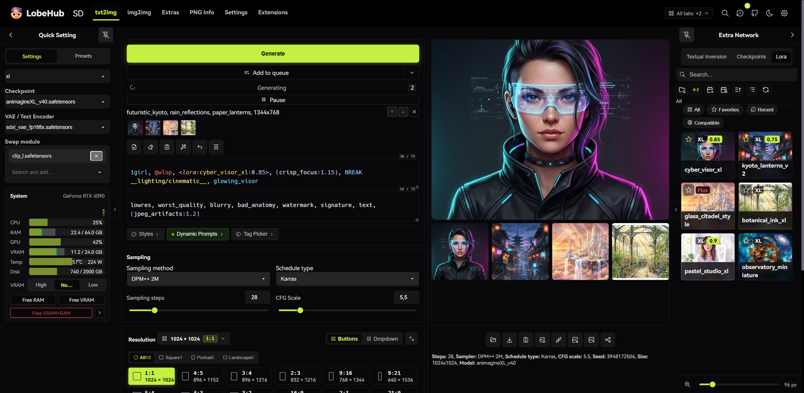
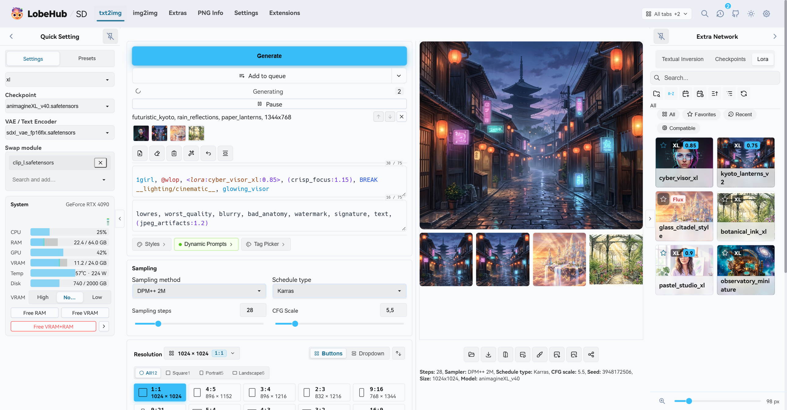
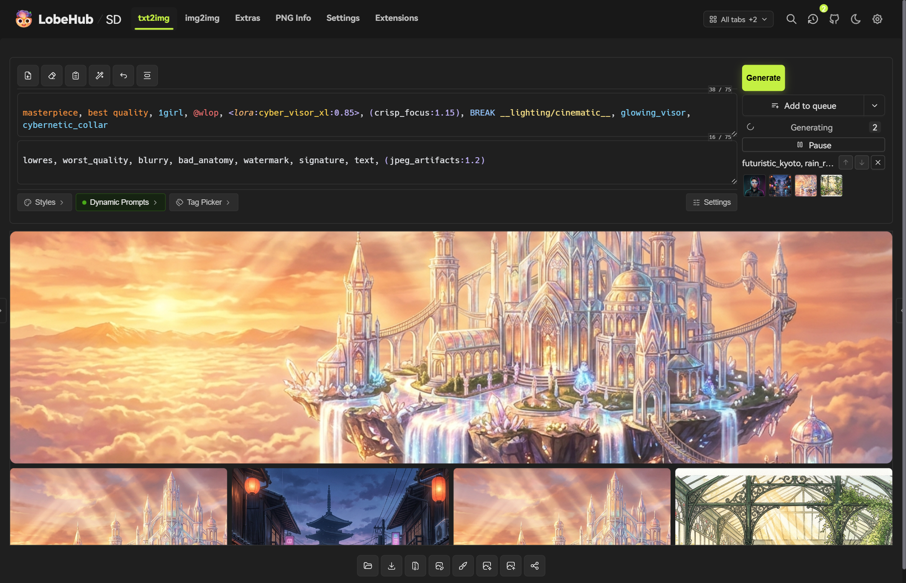
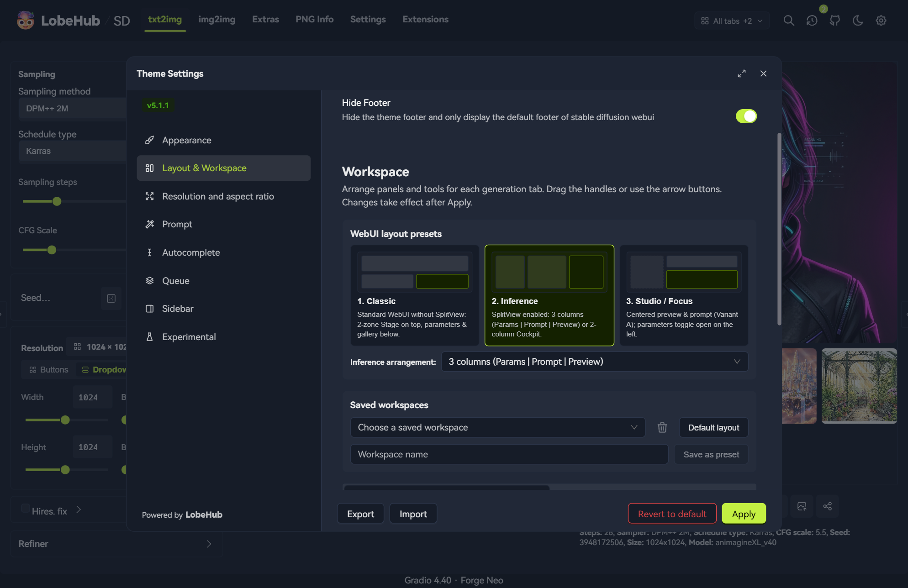
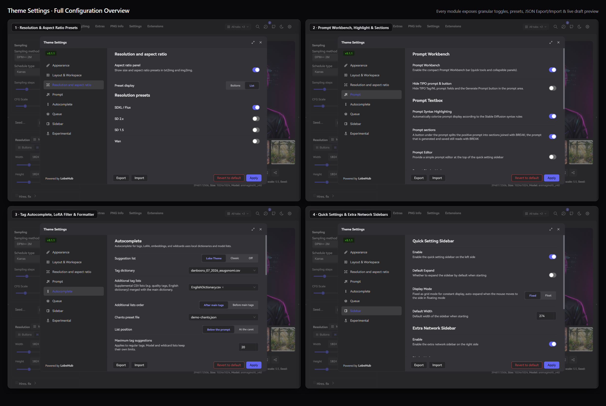
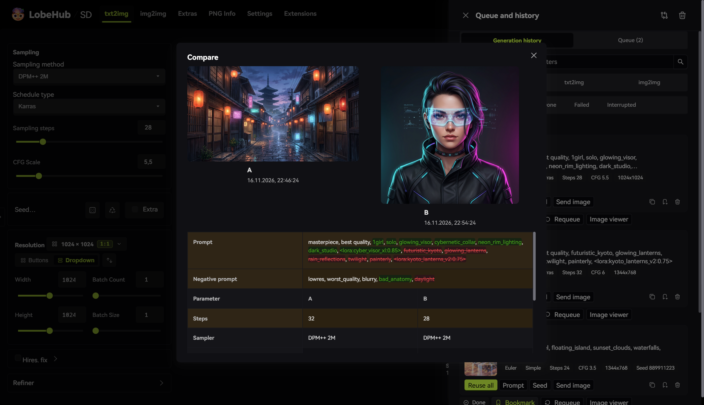
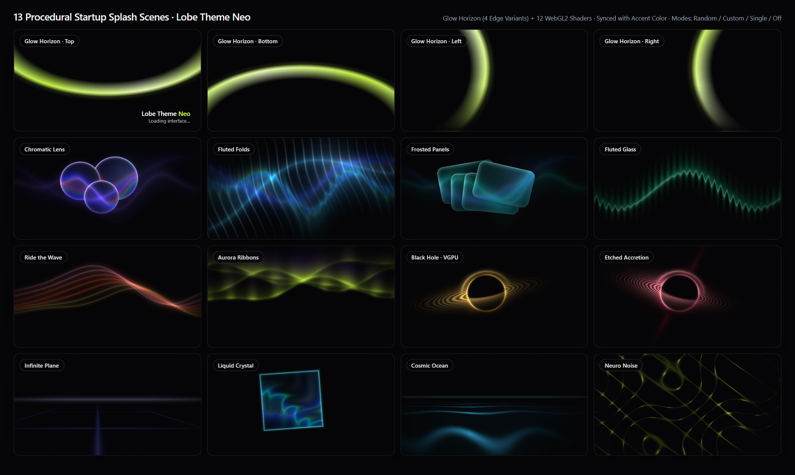
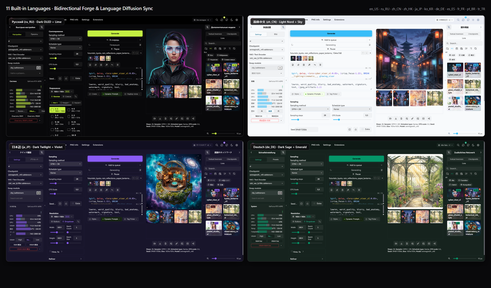

<div align="center">

# Lobe Theme Neo

面向 Stable Diffusion WebUI Forge Neo 的可定制工作区主题与内置效率工具集

[](./package.json)
[](https://github.com/Haoming02/sd-webui-forge-classic/tree/neo)
[](./package.json)
[](./package.json)
[](#多语言与本地字体)
[](./LICENSE)

[English](./README.md) · [Русский](./README.ru-RU.md) · [简体中文](./README.zh-CN.md)

<br />



*深色模式（`OLED` 中性色板，`Lime` 强调色），`1. Classic` 预设*

</div>

---

## 概览与布局预设

Lobe Theme Neo 基于 React 19、Ant Design 6、@lobehub/ui v6 与 TypeScript 重构了 Stable Diffusion WebUI Forge Neo (Gradio 4.x) 界面，并将 WebUI 旧版 Emoji 替换为 Tabler 线性 SVG 图标。除界面主题外，扩展还内置了基于 SQLite 的生成队列、历史记录与 A/B 对比、显存与内存查看器 Memory Keeper、提示词语法高亮与标签补全、自定义工作区布局以及 13 款程序化启动画面。

<table>
  <tr>
    <td width="50%" valign="top">
      <a href="./docs/assets/hero-dark-inference.png">
        
      </a>
      <p align="center"><b>深色 · OLED + Lime · 2. Inference（三栏布局）</b><br /><sub>参数、提示词与预览三栏并排，搭配内嵌队列与 Sampling 2×2</sub></p>
    </td>
    <td width="50%" valign="top">
      <a href="./docs/assets/preview-light-studio.png">
        
      </a>
      <p align="center"><b>浅色 · Nord + Sky · 1. Classic</b><br /><sub>浅色主题配快捷宽高比按钮网格与 Extra Networks 标签栏</sub></p>
    </td>
  </tr>
  <tr>
    <td colspan="2" align="center" valign="top">
      <a href="./docs/assets/preview-studio-focus.png">
        
      </a>
      <p align="center"><b>深色 · Kitchen + Lime · 3. Studio / Focus</b><br /><sub>顶部提示词与 Generate 控制区搭配居中大图预览，左侧参数抽屉可折叠</sub></p>
    </td>
  </tr>
</table>

---

## 界面与工作区定制

主题色彩、表面亮度、圆角、排版密度、Logo 与面板布局均支持无刷新切换，并可通过 JSON 导出/导入备份和迁移配置。

### 色彩、表面材质与 CIELAB 亮度


- **明暗模式：** 顶部栏即时切换 `Auto`、`Light`、`Dark` 或跟随系统外观。
- **24 种强调色：** 内置 `Lime`、`Crimson`、`Kitchen`、`Amber`、`Gold`、`Emerald`、`Teal`、`Cyan`、`Sky`、`Blue`、`Indigo`、`Violet`、`Purple`、`Pink`、`Rose` 与 `Mono`，自动计算按钮文字对比度。
- **12 套中性表面色板：** `Default`、`OLED`、`Kitchen`、`Zinc`、`Slate`、`Nord`、`Twilight`、`Mauve`、`Rosewood`、`Espresso`、`Sand` 与 `Sage`。
- **CIELAB 亮度微调（`-30%` 至 `+30%`）：** 按 5% 步进调整表面明暗度，保持文本与边框可读对比。
- **材质、圆角与密度：** 支持 `Flat`、`Glass`（磨砂半透明）与 `Elevated`；`Round` / `Soft` / `Sharp` 圆角；`Comfortable` / `Compact` 密度。
- **自定义 Logo、Favicon 与图标：** 支持 URL、Base64 或字符徽标并同步生成浏览器 Favicon，同时将 WebUI 原生 Emoji 替换为 Tabler 图标。
- **进度条与结果框动效：** 支持带步数与 ETA 的 `Aurora` 渐变进度条或 `Classic` 模式，以及 `Glow edge`、`Pulse`、`Ambient`、`Scan`、`Orbit` 预览动效。

### 灵活工作区



- **3 种布局预设：**
  1. **Classic：** 左侧参数与右侧预览并排展示的双区布局。
  2. **Inference（多栏模式）：** 3 栏并排（`参数 | 提示词 | 预览` 或 `预览 | 提示词 | 参数`）或适合宽屏的 2 栏驾驶舱布局。
  3. **Studio / Focus：** 顶部精简提示词与 Generate 栏配合下方居中画布，参数面板按需展开。
- **模块排序与多方案：** 按 `txt2img` / `img2img` 独立调整或隐藏 `Sampling`、`Seed`、`Resolution`、`Hires. fix`、`Refiner` 及扩展面板，自定义提示词框高度，最多保存 8 个方案。
- **双侧边栏：** 左侧快速设置栏（`设置 | 预设`）与右侧 Extra Networks 栏均支持 `Fixed` / `Float` 模式、拖拽调宽以及 64 px – 256 px 卡片缩放。

### 设置面板概览



每个功能模块在 **Theme Settings** 中都有对应选项卡：外观、布局与工作区、分辨率与宽高比、提示词、自动补全、队列、侧边栏与实验性选项，修改会保留在草稿中直到点击 `Apply`。

---

## 内置功能

### 提示词工作室、语法高亮与标签补全


- **Prompt Workbench：** 将 `Styles`、`Dynamic Prompts` 与标签选择器整合为可折叠区域，顶部配备读取参数、清空、复制、格式化、撤销/重做及分段开关按钮。
- **分段卡片（Prompt Sections）：** 按 `BREAK` 拆分为独立可编辑卡片，并分别估算每段 Token 数。
- **语法高亮：** 可单独开关 Danbooru / e621 分类标签、`<lora:...>` 模型、权重括号 `(tag:1.2)`、`__通配符__` 及 `BREAK` / `AND` 关键词高亮。
- **内置自动补全与 Dynamic Prompts：**
  - 内置 Danbooru / Gelbooru 词库、英语词典、Chants 常用串以及 1,702 个通配符模板（`assets/wildcards/`），并附带 Wildcards 管理器标签页（`scripts/dynamic_prompts.py`）。
  - 输入 `<lora:...>` 时按当前大模型架构（`SDXL`、`Flux`、`Illustrious`、`SD 1.5`、`Pony`、`SD 3` 等）优先筛选兼容模型，并可插入触发词或 ANIMA `@画师` 前缀。
  - 通过本地 SQLite 统计标签使用频率，淡化已输入标签，支持 `Alt+Shift+F` 或失焦整理逗号空格并展示 Diff 对比。

### 生成队列、历史记录与 A/B 对比



- **内置生成队列：** 提供 `Add to queue` 复合按钮（`Ctrl/Cmd+Shift+Enter`）与 `Generate` 下方的内嵌进度条，支持暂停/继续、优先级调整、JSON 导入导出及自动迁移 `agent-scheduler-neo` 数据。
- **批量队列与完成后操作：** 支持按当前模型、勾选模型、文件夹内全部模型或全部大模型入队；队列完成后可执行无操作、睡眠、休眠、关机或停止 WebUI。
- **历史记录与 A/B 对比：** 在 `lobe_data/theme.sqlite3` 中保存最多 2,000 条记录与缩略图，支持全文搜索、收藏、还原全部参数 / 仅提示词 / 仅种子、存为预设、键盘切换结果灯箱（`←` / `→` / `Esc`）以及带 `TokenDiff` 高亮的双图 A/B 对比窗口。

### Memory Keeper、硬件监控与命令面板


- **Memory Keeper：** 按 WebUI、子进程与其他程序划分显存和系统内存占用。展开详情可查看已加载的大模型（拆分为 UNet、Text Encoder、VAE）与 LoRA，支持常驻锁定（跨重启保持）、卸载至系统内存、单项释放以及免重启切换 `VRAM Mode`（`High` / `Normal` / `Low`）。
- **系统监视器：** 基于 NVML 实时读取 CPU、RAM、GPU 负载、显存、温度、功耗曲线与磁盘占用。
- **命令面板（`Ctrl+K` / `⌘K`）：** 模糊检索操作（`Generate`、`Interrupt`、`Skip`、预设、采样器、调度器、大模型、LoRA、近期历史、设置与标签页），顶部标签菜单支持搜索与钉选。

### 启动动画场景



在 Gradio 挂载完成前提供 13 款程序化启动动画消除白屏：包含 CSS 极光场景 **Glow Horizon** 的 4 种边缘出现变体（`Top`、`Bottom`、`Left`、`Right`）以及 12 款实时 WebGL2 着色器（`Chromatic Lens`、`Fluted Folds`、`Frosted Panels`、`Fluted Glass`、`Ride the Wave`、`Aurora Ribbons`、`Black Hole · VGPU`、`Etched Accretion`、`Infinite Plane`、`Liquid Crystal`、`Cosmic Ocean`、`Neuro Noise`）。颜色与当前强调色联动，支持 `Random`、`Custom`、`Single` 与 `Off` 模式。

---

## 更多实用功能

- **LoRA 卡片工具：** 悬停增减权重或滚轮调节（同步更新提示词中的权重）、收藏标记、快捷筛选（`All`、`Favorites`、`Recent`、`Compatible`）、插入触发词与模型架构兼容性标签（`XL`、`Flux` 等）。
- **分辨率与宽高比面板：** 在下拉框与按钮网格之间切换（内置 `SDXL/Flux`、`SD 2.x`、`SD 1.5`、`Wan` 分组），支持 `⇄` 宽高互换、比例锁定缩放、模型推荐参数提醒、Sampling 2×2 布局及 Chaotic Seed 生成。
- **Windows 大模型兼容：** 内置 `safetensors_compat.py` 启用 `backend="pread"`，避免 Windows 加载超过 4 GB Safetensors 文件时触发 `mmap` 报错。
- **参数预设：** 在左侧边栏保存常用采样器、步数、CFG、尺寸及可选 Seed / Batch 参数。

---

## 多语言与本地字体



- **11 种界面语言：** `English (en_US)`、`简体中文 (zh_CN)`、`繁體中文 (zh_HK)`、`Русский (ru_RU)`、`日本語 (ja_JP)`、`한국어 (ko_KR)`、`Deutsch (de_DE)`、`Español (es_ES)`、`Français (fr_FR)`、`Português (pt_BR)`、`Türkçe (tr_TR)`，并与 Forge 原生语言及 `sd-webui-language-diffusion` 双向同步。
- **本地离线字体：** UI 字体（`HarmonyOS Sans`、`Inter`、`Geist`、`System UI`）与提示词等宽字体（`Hack`、`Geist Mono`、`System UI`）均内置在 `assets/fonts/`，不依赖外部 CDN。

---

## 兼容性与快捷键

| 组件 / 扩展 | 支持状态 | 说明 |
| --- | --- | --- |
| **Forge Neo (Gradio 4.x)** | 原生适配 | 针对 Forge Neo 的 DOM 结构、Gradio 4 组件与模型预设编写 |
| **内置 Tag 自动补全** | 内置提供 | 若检测到外部已安装 `a1111-sd-webui-tagcomplete` 将自动让渡控制权 |
| **内置 Dynamic Prompts** | 内置提供 | 未安装外部 DP 扩展时自动启用内置脚本与 Wildcards 管理器（`assets/wildcards/`） |
| **内置生成队列** | 内置提供 | 自动识别并迁移 `agent-scheduler-neo` 的 SQLite 任务与历史记录 |
| **ADetailer / ControlNet / TIPO** | 按需集成 | 仅在用户自行安装相应扩展时应用主题色板、Tabler 图标与兼容逻辑 |
| **SD WebUI 1.x / A1111 (Gradio 3)** | 不适用 | 传统 Gradio 3 WebUI 请使用上游 [`lobehub/sd-webui-lobe-theme`](https://github.com/lobehub/sd-webui-lobe-theme) |

<details>
<summary><b>快捷键</b></summary>

| 快捷键 | 功能 |
| --- | --- |
| `Ctrl+K` / `⌘K` | 打开命令面板 |
| `Ctrl+Enter` / `⌘Enter` | 立即生成 |
| `Ctrl+Shift+Enter` / `⌘Shift+Enter` | 将当前提示词加入队列 |
| `Alt+Shift+F` | 格式化提示词并预览 Diff |
| `←` / `→` / `Esc` | 切换或关闭结果灯箱与对比窗口 |

</details>

---

## 安装与更新

### 通过 Forge Neo 界面安装（推荐）

> 仓库中已包含预编译的前端构建产物（`javascript/main.mjs` 与 `javascript/chunks/*`），无需安装 Node.js。

1. 打开 Stable Diffusion WebUI Forge Neo。
2. 进入 **Extensions → Install from URL**。
3. 填入仓库地址并点击 **Install**：
   ```text
   https://github.com/LeonWGal/lobe-theme-neo
   ```
4. 打开 **Extensions → Installed**，点击 **Check for updates**，然后点击 **Apply and restart UI**。

### 手动 Git 克隆

```bash
cd path/to/sd-webui-forge-neo/extensions
git clone https://github.com/LeonWGal/lobe-theme-neo.git
```

通过启动器完整重启 Forge Neo，以确保 `preload.py` 与后端路由 `/lobe/*` 正常注册。

> [!NOTE]
> 用户配置 `lobe_theme_config.json` 与 `lobe_data/` 目录已列入 `.gitignore`，通过 Git 更新不会覆盖个人配置或历史记录。

---

## 开发与测试

技术栈：React 19、Ant Design 6、@lobehub/ui v6、antd-style、Zustand、Vite 5、TypeScript、Python。

### 前端

```bash
npm install

# 启动 Vite 开发服务器
npm run dev

# 构建生产包至 javascript/main.mjs 与 javascript/chunks/
npm run build

# 运行 ESLint 与 TypeScript 检查
npm run ci

# 运行 Vitest 单元测试
npm test
```

### Python 后端测试

在 Forge Neo 的 Python 虚拟环境中执行：

```bash
python -B -m unittest discover -s tests -p "test_*.py" -v
```

### 目录结构

```text
lobe-theme-neo/
├── assets/
│   ├── autocomplete/       # Danbooru/Gelbooru/英语词表、Chants 与 JS 补全引擎
│   ├── boot/               # WebGL2 启动动画场景着色器 (scenes.mjs)
│   ├── fonts/              # 本地 HarmonyOS Sans, Inter, Geist, Hack, Mono 字体
│   └── wildcards/          # 1,702 个内置通配符文件
├── docs/assets/            # README 截图资源
├── javascript/             # 预构建 Vite 产物及 aspect_ratio / boot / queue 桥接脚本
├── locales/                # 11 套界面语言包 + options.json
├── scripts/                # FastAPI 路由、SQLite 队列历史、Memory Keeper、DP 与 pread 补丁
├── src/                    # React 19 / TypeScript 前端源码
└── tests/                  # Vitest 与 Python 单元测试
```

---

## 致谢与协议

- 基于 LobeHub 的 [sd-webui-lobe-theme](https://github.com/lobehub/sd-webui-lobe-theme)，迁移至 Gradio 4.x / React 19 / Ant Design 6 并为 Forge Neo 扩展重构。
- 内置标签补全与动态提示词功能适配自 `a1111-sd-webui-tagcomplete` / `sd-webui-tagcomplete-neo` 与 `sd-dynamic-prompts`。
- 基于 GNU Affero General Public License v3.0 ([AGPL-3.0](./LICENSE)) 开源。
